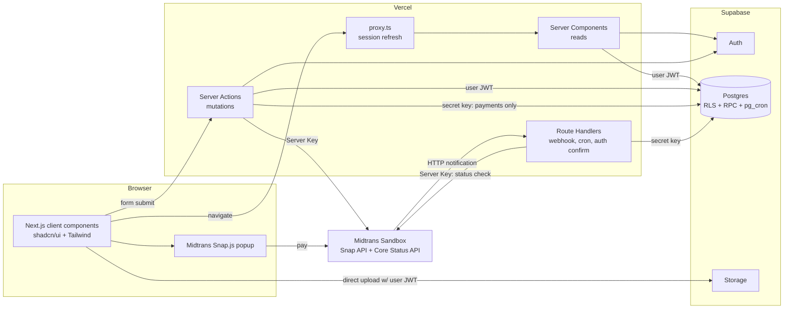
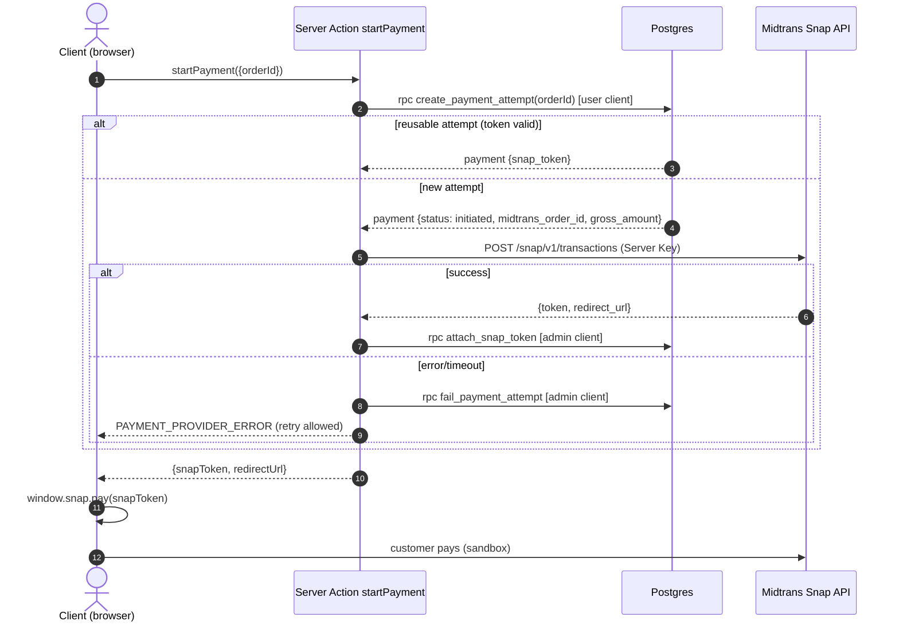
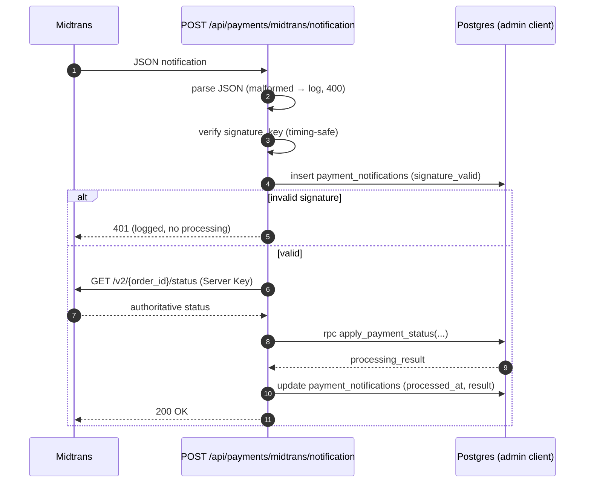

# Projekin — Application Architecture

| | |
|---|---|
| Status | Draft for approval |
| Version | 0.2 (2026-11-13), with product-owner decisions on Q1, Q3, Q6 and the database environment |
| Related | [PRD.md](PRD.md), [DATABASE.md](DATABASE.md), [API_CONTRACT.md](API_CONTRACT.md), [IMPLEMENTATION_PLAN.md](IMPLEMENTATION_PLAN.md) |

---

## 1. Principles

1. **The database is the last line of defence.** Every authorization rule is enforced in Postgres (RLS, column grants, `SECURITY DEFINER` RPCs). Server code re-checks rules for good error messages, but correctness never depends on it.
2. **State changes are atomic database functions.** A status transition is one RPC call inside one transaction, never a sequence of client-side updates.
3. **The server computes money.** Prices, fees and payment amounts come from database rows, never from request payloads.
4. **Payment truth comes from Midtrans's server API.** Browser callbacks are UX only. Notifications are verified (signature), then confirmed through the Status API.
5. **Keep it boring.** One Next.js app, one Supabase project per environment, no extra services (queues, Redis, search engines) in the MVP.

---

## 2. System context



---

## 3. Technology stack

| Layer | Choice | Notes |
|---|---|---|
| Runtime | Node.js 24 LTS | Matches the dev container |
| Framework | Next.js App Router, latest stable at scaffold time (16.x+) | Exact version pinned in `package.json`. Session refresh lives in `proxy.ts` (called `middleware.ts` before Next 16). |
| Language | TypeScript, `strict: true`, `noUncheckedIndexedAccess: true` | No `any` without a justification comment |
| UI | Tailwind CSS v4, shadcn/ui (Radix primitives), lucide-react icons, sonner toasts | Copy in Bahasa Indonesia (§11.6) |
| Forms | react-hook-form + Zod resolver | The same Zod schemas validate on the server |
| Validation | Zod | `src/lib/validation/*` |
| Data | `@supabase/supabase-js`, `@supabase/ssr` | Generated types `src/types/database.ts` |
| Payments | Midtrans Snap (Sandbox) through a thin typed `fetch` wrapper | No Midtrans Node SDK (untyped CommonJS, unnecessary for 3 endpoints) |
| Hosting | Vercel (app + Vercel Cron), Supabase Cloud | |
| Tests | Vitest, Testing Library, Playwright, pgTAP (`supabase test db`) | See [IMPLEMENTATION_PLAN §4](IMPLEMENTATION_PLAN.md#4-testing-strategy) |
| Tooling | ESLint (flat config, `next/core-web-vitals` + `typescript-eslint` strict), Prettier, Supabase CLI (npm dev dependency, run with `npx supabase`) | |

---

## 4. Environments and configuration

| Environment | App | Database | Midtrans |
|---|---|---|---|
| Local (dev container) | `npm run dev` (port 3000) | Hosted **dev** project on supabase.com | Sandbox. Webhooks need a tunnel; otherwise return-sync covers it (§9.4). |
| CI (GitHub Actions) | `next build && next start` | **Ephemeral** Supabase CLI local stack (`supabase start`; Docker is available on GitHub runners) | Mocked |
| Preview | Vercel preview deployments | Hosted **dev** project | Sandbox (shared merchant; IDs carry random suffix) |
| Production (demo) | Vercel production | Hosted **prod** Supabase project | Sandbox (MVP). `MIDTRANS_IS_PRODUCTION` must stay `false`. |

**Decision (2026-11-13):** development uses a hosted supabase.com project instead of a local Docker stack. See §4.2 for the workflow.

### 4.1 Environment variables

| Name | Exposure | Purpose |
|---|---|---|
| `NEXT_PUBLIC_SITE_URL` | public | Absolute base URL for auth email redirects and the Snap `finish` callback |
| `NEXT_PUBLIC_SUPABASE_URL` | public | Supabase project URL |
| `NEXT_PUBLIC_SUPABASE_PUBLISHABLE_KEY` | public | Publishable key (`sb_publishable_…`), or the legacy anon key |
| `SUPABASE_SECRET_KEY` | **server only** | Secret key (`sb_secret_…`), or the legacy service-role key. Bypasses RLS. |
| `NEXT_PUBLIC_MIDTRANS_CLIENT_KEY` | public | Loads Snap.js |
| `MIDTRANS_SERVER_KEY` | **server only** | Snap API, Status API, signature verification |
| `MIDTRANS_IS_PRODUCTION` | server | Must be `"false"`. Startup validation throws if it is anything else (MVP guard). |
| `CRON_SECRET` | **server only** | Bearer token Vercel Cron sends to `/api/cron/*` |

- Validated at startup with Zod in `src/lib/env/server.ts` (imports `server-only`) and `src/lib/env/client.ts`.
- `.env.example` is committed with empty values. `.env.local` is git-ignored.
- CLI-only credentials (`SUPABASE_ACCESS_TOKEN` from `npx supabase login`, and the database password used by `supabase link`/`db push`) are never app env vars and are never committed.
- Midtrans base URLs come from `MIDTRANS_IS_PRODUCTION`: Snap `https://app.sandbox.midtrans.com/snap/v1/transactions`, Core `https://api.sandbox.midtrans.com/v2`, Snap.js `https://app.sandbox.midtrans.com/snap/snap.js`.

### 4.2 Database workflow (hosted Supabase)

| Task | How | Docker needed |
|---|---|---|
| Projects | Two projects on supabase.com: `projekin-dev` (local development + Vercel preview) and `projekin-prod`. The Free plan allows 2 active projects and **pauses a project after a period of inactivity**; resume it from the dashboard. | — |
| Link | `npx supabase link --project-ref <dev-ref>` | No |
| Write migrations | Hand-written SQL in `supabase/migrations/` (`npx supabase migration new <name>`). `supabase db diff` is **not** used because it needs Docker. | No |
| Apply to dev | `npx supabase db push` (applies pending migrations only). Agents may push **additive** migrations to dev. | No |
| Apply to prod | `npx supabase db push` against the prod link, **only with explicit approval**, at release. | No |
| Reset | `supabase db reset --linked` is destructive and **never** run without explicit approval (CLAUDE.md rule 16). | — |
| Types | `npx supabase gen types typescript --project-id <dev-ref> > src/types/database.ts` | No |
| DB tests (local feedback) | `pg_prove` against the **dev** project. Every test file runs inside `BEGIN … ROLLBACK`, so it leaves no data behind. Needs `postgresql-client` and `pg_prove` in the dev container (proposed in Phase 0; needs approval because it changes `.devcontainer/`) and the `pgtap` extension enabled on dev. | No |
| DB tests (authoritative) | CI: `supabase start` → `supabase db reset` → `supabase test db` on a fresh, empty stack | Yes (GitHub runner) |
| Auth emails in dev | The hosted project's built-in sender is heavily rate-limited. Create dev users in the dashboard with "Auto Confirm User", or configure custom SMTP early. Site URL `http://localhost:3000`. Add the Vercel preview URL pattern to the redirect allow-list. | — |

Because the dev database is shared with preview deployments and is never empty, tests must create their own fixtures and must not assume empty tables (for example, scope counts to fixture users).

---

## 5. Repository structure

```
.
├── docs/                         # This blueprint
├── supabase/
│   ├── config.toml
│   ├── migrations/               # Timestamped SQL (DATABASE §14)
│   ├── seed.sql                  # CI-only test data (reference data is a migration)
│   └── tests/                    # pgTAP: rls_*.test.sql, rpc_*.test.sql
├── src/
│   ├── app/
│   │   ├── (public)/             # Landing, services, jobs, profiles, auth pages
│   │   ├── onboarding/
│   │   ├── dashboard/            # Authenticated area (layout enforces session + onboarding)
│   │   ├── admin/                # Admin area (layout enforces is_admin)
│   │   ├── auth/confirm/route.ts
│   │   └── api/
│   │       ├── payments/midtrans/notification/route.ts
│   │       └── cron/reconcile-payments/route.ts
│   ├── components/
│   │   ├── ui/                   # shadcn/ui generated components
│   │   └── <domain>/             # services/, jobs/, orders/, profile/ ...
│   ├── server/
│   │   ├── actions/              # 'use server' modules, one per domain (API_CONTRACT §4)
│   │   ├── auth.ts               # requireUser / requireOnboarded / requireAdmin
│   │   ├── errors.ts             # Postgres error → ActionResult mapping
│   │   └── payments/             # midtrans-client.ts, signature.ts, status-map.ts, process-status.ts
│   ├── lib/
│   │   ├── supabase/             # server.ts, browser.ts, admin.ts (server-only), proxy.ts
│   │   ├── validation/           # Zod schemas (shared client/server)
│   │   ├── env/                  # server.ts, client.ts
│   │   ├── format.ts             # IDR, dates (Asia/Jakarta), order code PJK-000123
│   │   └── storage.ts            # path builders, public URL helper
│   ├── types/database.ts         # Generated by Supabase CLI. Never hand-edited.
│   └── proxy.ts
├── tests/
│   ├── unit/                     # Vitest
│   ├── integration/              # Vitest against the CI ephemeral Supabase stack
│   └── e2e/                      # Playwright
├── .env.example
└── vercel.json                   # Cron definitions
```

---

## 6. Data access and rendering

### 6.1 Reads

- **Server Components** read through the **user-scoped** Supabase server client, so RLS applies to every read. There is no custom REST read API.
- Pages are dynamically rendered (they depend on the session cookie). After mutations, Server Actions call `revalidatePath` on the affected routes. Caching optimisations are post-MVP.
- Public list pages (`/services`, `/jobs`) take validated `searchParams` ([API_CONTRACT §5](API_CONTRACT.md#5-read-contracts-pages-and-queries)).
- Private files are rendered through short-lived signed URLs created server-side with the user client.

### 6.2 Writes

- **Server Actions** handle every user mutation:
  1. Parse input with Zod. Return `VALIDATION_ERROR` on failure.
  2. `requireUser()` / `requireOnboarded()` / `requireAdmin()`.
  3. Call an RPC, or make a granted direct write, with the **user** client.
  4. Map Postgres errors to `ActionResult` (`src/server/errors.ts`).
  5. `revalidatePath` and return `ActionResult<T>`.
- **Route Handlers** serve only external callers: the Midtrans notification, Vercel Cron, and the Supabase email confirmation link.
- **File uploads** go directly from the browser to Supabase Storage with the user's JWT. Bucket policies restrict the path, and bucket limits restrict size and MIME type. The browser then passes the object **path** to a Server Action, and the RPC or RLS check verifies the path prefix (and, for documents and deliveries, that the object exists).

### 6.3 Supabase clients

| Client | File | Key | Used by | RLS |
|---|---|---|---|---|
| Browser | `lib/supabase/browser.ts` | publishable | Client components: auth forms, storage uploads | Yes |
| Server (user) | `lib/supabase/server.ts` | publishable + session cookies | Server Components, Server Actions | Yes |
| Admin | `lib/supabase/admin.ts` (`import 'server-only'`) | **secret** | **Only:** payment functions in `src/server/payments/**` (attach token / fail attempt / apply status), called by the `startPayment` and `syncPaymentStatus` actions after they authorize the user, plus the Midtrans notification handler and the reconcile cron | **Bypassed** |

Rules for the admin client:
- Never import it from a component file. ESLint `no-restricted-imports` blocks `lib/supabase/admin` outside `src/server/payments/**` and `src/app/api/**`. Server Actions reach it only through functions exported from `src/server/payments/`. `cancelOrder` needs only the Midtrans client (to expire transactions), not the admin DB client.
- Never use it to read data on behalf of a user without first authorizing that user through the user client.
- Only call `service_role`-granted RPCs with it (`attach_snap_token`, `fail_payment_attempt`, `apply_payment_status`) and read `payments` rows. Never use it for generic table writes.

---

## 7. Authentication and session

- Supabase Auth, email and password, **"Confirm email" enabled**. No session is issued before confirmation.
- `@supabase/ssr` cookie sessions. `proxy.ts` refreshes the session on every matched request and redirects unauthenticated visitors away from `/dashboard/**`, `/admin/**` and `/onboarding` to `/login?next=…`.
- **The proxy is not a security boundary.** Every protected layout, page and action re-checks with `requireUser()`. It uses `supabase.auth.getClaims()` (JWT verified) or `getUser()`, and **never trusts `getSession()`** on the server.
- `requireOnboarded()` redirects to `/onboarding` when `profiles.onboarded_at` is null. Actions return `FORBIDDEN` / `NOT_ONBOARDED` instead.
- `requireAdmin()` checks `admin_users` membership through the user client (RLS: own row). Non-admins get `notFound()`, so the admin area is never revealed.
- Email links (confirmation, recovery) point to `/auth/confirm?token_hash=…&type=…&next=…`. The handler calls `verifyOtp`. `next` is accepted only if it is a relative path beginning with a single `/` (blocks open redirects).
- Supabase Auth settings: minimum password length 8, leaked-password protection on if the plan allows it, custom SMTP before pilot (PRD A5), site URL and redirect allow-list per environment.

---

## 8. Authorization model

Each rule is enforced in several layers:

| Layer | What it does | Bypassable by a malicious client? |
|---|---|---|
| UI | Hides buttons the user can't use | Yes (UX only) |
| Server Action | Zod validation, role check, friendly errors | Yes, if someone calls PostgREST directly with their JWT |
| RPC function | Role, ownership, state and limit checks; atomic writes | **No** |
| RLS + column grants | Row visibility, owner-only content writes, protected columns | **No** |
| Storage policies + bucket limits | Path ownership, size, MIME | **No** |

Because users hold a valid JWT and the publishable key is public, **any user can call PostgREST and RPCs directly**. The design assumes this. Every RPC re-validates everything, including input lengths and ranges (in addition to table `CHECK` constraints).

Capability matrix (summary; the authoritative rules are [DATABASE §7, §9](DATABASE.md#7-rpc-functions-public-schema)):

| Capability | Visitor | Client | Freelancer (verified) | Admin |
|---|---|---|---|---|
| Browse services, jobs, profiles, reviews | ✓ | ✓ | ✓ | ✓ |
| Post job, order service, hire | — | ✓ (onboarded) | ✓ | ✓ |
| Publish service, submit proposal | — | — | ✓ | only if also verified |
| View/act on an order | — | own (client side) | own (freelancer side) | read all, resolve disputes |
| Review student documents, resolve disputes, mark refunds/payouts, moderate | — | — | — | ✓ |

---

## 9. Payment architecture

### 9.1 Components

| Component | Responsibility |
|---|---|
| `server/payments/midtrans-client.ts` | `createSnapTransaction`, `getTransactionStatus`, `expireTransaction`. Basic auth `base64(serverKey + ':')`, 10 s timeout, typed responses. |
| `server/payments/signature.ts` | `verifyNotificationSignature(payload)`: `SHA512(order_id + status_code + gross_amount + serverKey)` compared with `crypto.timingSafeEqual` |
| `server/payments/status-map.ts` | Mirrors the mapping table in [DATABASE §8.2](DATABASE.md#82-payment-attempt-and-apply_payment_status), for display and logging only (the database does the authoritative mapping). |
| `server/payments/process-status.ts` | `syncAndApply(midtransOrderId)`: Status API → parse `gross_amount` to integer → `apply_payment_status` RPC (admin client) → result |
| `app/api/payments/midtrans/notification/route.ts` | Webhook endpoint |
| `app/api/cron/reconcile-payments/route.ts` | Reconciliation |
| `components/orders/pay-button.tsx` | Loads Snap.js (client key), calls `startPayment`, opens `window.snap.pay(token, callbacks)`, calls `syncPaymentStatus` on every callback |

### 9.2 Checkout flow



Snap request body (built server-side from DB rows only):

```json
{
  "transaction_details": { "order_id": "PJK-000123-1-a1b2c3d4", "gross_amount": 150000 },
  "item_details": [{ "id": "<orders.id>", "price": 150000, "quantity": 1, "name": "<orders.title, max 50 chars>" }],
  "customer_details": { "first_name": "<profiles.full_name, max 50 chars>", "email": "<auth user email>" },
  "expiry": { "start_time": "<now, yyyy-MM-dd HH:mm:ss +0700>", "unit": "minute", "duration": "<floor((payment_due_at - now) in minutes)>" },
  "callbacks": { "finish": "<NEXT_PUBLIC_SITE_URL>/dashboard/orders/<orders.id>?payment=finish" }
}
```

`token_expires_at` = `start_time + duration`, which is always ≤ `payment_due_at` (BR-10).

### 9.3 Notification (webhook) flow



- `unknown_payment` (for example, an order from another environment) and `amount_mismatch` still return **200**, so Midtrans stops retrying. Both are logged. `amount_mismatch` is logged at error level for investigation.
- Unexpected errors (DB down, Status API timeout) return **500**, so Midtrans retries the notification.
- Set the Notification URL in the Midtrans Sandbox dashboard to `https://<prod-domain>/api/payments/midtrans/notification`. Preview and local environments rely on return-sync (§9.4) and reconciliation (§9.5).

### 9.4 Return sync

When the Snap popup fires `onSuccess`, `onPending`, `onError` or `onClose`, or the user lands on `?payment=finish`, the order page calls `syncPaymentStatus({orderId})`. The action:

1. Authorizes the caller as the order client (user client reads the order).
2. Finds the latest attempt with status `initiated`/`pending` (or the most recent attempt).
3. Calls `syncAndApply` (Status API, then `apply_payment_status`).
4. Returns the order status.

A Status API `404` means no transaction exists yet (the user closed Snap before choosing a method). That is not an error: the attempt stays `pending` until its token expires.

This makes payments work in local development without a public webhook URL, and it heals missed notifications.

### 9.5 Reconciliation

`GET /api/cron/reconcile-payments` (requires `Authorization: Bearer ${CRON_SECRET}`; Vercel Cron sends this automatically when `CRON_SECRET` is set):

- Selects up to 100 payments with `status IN ('initiated','pending')` and `created_at < now() - 10 min`, ordered by `last_synced_at NULLS FIRST`.
- Runs `syncAndApply` for each, sequentially, with a short delay between calls.
- `initiated` attempts with no token older than 10 minutes: `fail_payment_attempt('stale_initiated')`.

### 9.6 Edge cases

| Case | Handling |
|---|---|
| User pays after the order was cancelled (VA paid late, or a cancel race) | `apply_payment_status` marks the payment `paid` and sets `refund_status='pending'`. Event `late_payment_detected`. Appears in the admin refunds queue (BR-24). |
| Two attempts both get paid | The second is flagged `duplicate_payment_detected` with refund pending. Prevented in normal use by the one-live-attempt index and token reuse. |
| Client cancels while a VA is pending | `cancel_order` returns the live `midtrans_order_id`s. The action calls Midtrans `POST /v2/{id}/expire` (best effort). If that fails, the late-payment path above applies. |
| Notification arrives before `attach_snap_token` commits | The payment row already exists (`initiated`). `apply_payment_status` handles any status from `initiated`. |
| Duplicate or out-of-order notifications | Idempotent: regression guard plus Status API as the source of truth. |
| `amount_mismatch` | No state change. Logged at error level, visible in `payment_notifications`. |
| Snap API down | Attempt marked `failed`. The client retries (counts toward BR-11). |
| Order payment window closes during checkout | `create_payment_attempt` refuses within 5 minutes of `payment_due_at`. Snap expiry is aligned with the deadline. |
| Card `challenge` (fraud review) | Stays `pending`. A later notification resolves it. |
| Refund/chargeback notification | Payment → `refunded`. The order status is unchanged, and the admin investigates (event `payment_refunded_by_provider`). |

---

## 10. Background jobs

| Job | Runtime | Why there |
|---|---|---|
| Expire unpaid orders (every 5 min) | `pg_cron` → `expire_unpaid_orders()` | DB-only. Independent of Vercel plan limits. |
| Auto-complete delivered orders (hourly) | `pg_cron` → `auto_complete_delivered_orders()` | DB-only |
| Reconcile pending payments | Vercel Cron → route handler | Needs the Midtrans Server Key. Vercel Hobby allows only daily cron, so we use daily there and every 15 minutes on Pro. Return-sync covers the common path. |

`vercel.json`:

```json
{ "crons": [{ "path": "/api/cron/reconcile-payments", "schedule": "0 3 * * *" }] }
```

---

## 11. Cross-cutting concerns

### 11.1 Error handling

- Server Actions never throw to the client for expected failures. They return `ActionResult` ([API_CONTRACT §1.2](API_CONTRACT.md#12-result-envelope)). Unexpected errors are logged and returned as `INTERNAL_ERROR` with a correlation ID.
- `error.tsx` and `not-found.tsx` exist at the root, under `dashboard/` and under `admin/`.

### 11.2 Logging

- Structured JSON through a small `log(level, event, fields)` helper writing to stdout (Vercel logs).
- Required events: `payment.attempt.created`, `payment.snap.error`, `payment.notification.received`, `payment.notification.invalid_signature`, `payment.status.applied`, `payment.amount_mismatch`, `cron.reconcile.summary`.
- **Never log:** server key, secret key, signature values, Snap tokens, emails, student numbers, document paths, message bodies.
- External error tracking (for example, Sentry) is optional and post-MVP.

### 11.3 Formatting

- IDR: `Intl.NumberFormat('id-ID', { style: 'currency', currency: 'IDR', maximumFractionDigits: 0 })`.
- Dates: `Intl.DateTimeFormat` with `timeZone: 'Asia/Jakarta'`.
- Order code: `PJK-${String(order_number).padStart(6, '0')}`.

### 11.4 User-generated content

Rendered as plain text (`whitespace-pre-wrap`), never through `dangerouslySetInnerHTML` (BR-26). External URLs (portfolio) render with `rel="noopener noreferrer nofollow ugc"` and must start with `https://`.

### 11.5 Images

`next/image` with `remotePatterns` restricted to the project's Supabase Storage public URL path.

---

### 11.6 Language (Bahasa Indonesia)

- `src/app/layout.tsx` sets `<html lang="id">`. Copy is written in Indonesian directly in components. There is no i18n framework (PRD Q1).
- Validation messages come from a shared Indonesian Zod error map (`src/lib/validation/messages.ts`) applied on both client and server.
- Action error messages come from `src/server/error-messages.ts`, keyed by `reason` ([API_CONTRACT §7](API_CONTRACT.md#7-postgres--actionresult-mapping)).
- Supabase Auth email templates (confirm signup, reset password, change email) are translated in each project's dashboard and point at `/auth/confirm`.
- The Snap popup is opened with its language option set to Indonesian.
- Numbers, currency and dates use the `id-ID` locale (§11.3).

## 12. Security

### 12.1 Security headers (`next.config.ts`)

- `Strict-Transport-Security` (Vercel default on custom domains), `X-Content-Type-Options: nosniff`, `Referrer-Policy: strict-origin-when-cross-origin`, `Permissions-Policy: camera=(), microphone=(), geolocation=()`.
- `Content-Security-Policy`: `frame-ancestors 'none'` from day one. The full CSP (script, frame and connect sources for Snap and Supabase) ships **Report-Only** first in Phase 10 and is tuned against the origins Snap actually loads in sandbox, then enforced.

### 12.2 Risk register

L = likelihood, I = impact (H/M/L).

| ID | Risk | L | I | Mitigation | Verified by |
|---|---|---|---|---|---|
| SR-01 | **RLS misconfiguration** exposes or allows changes to other users' rows | M | H | RLS on every table; default-deny; column grants; pgTAP tests for every row of the policy matrix (anon, other user, owner, admin) | `supabase/tests/rls_*.test.sql` |
| SR-02 | **Secret key or Midtrans server key leak** | L | H | Server-only env, `server-only` import guard, ESLint import restriction, no `NEXT_PUBLIC_` prefix, secret scanning in GitHub | CI lint; build-output grep for key prefixes |
| SR-03 | **Price or amount tampering** | M | H | Amounts computed in RPC from DB rows; Snap body built from DB; webhook `amount_mismatch` check | RPC tests; webhook tests |
| SR-04 | **Spoofed payment notification** | M | H | SHA-512 signature check (timing-safe) **and** Status API confirmation before applying | Webhook unit and integration tests with forged payloads |
| SR-05 | **Replay or out-of-order notifications** | M | M | Idempotent `apply_payment_status` with regression guard | RPC tests |
| SR-06 | **Client-side payment callback trusted** | M | H | Snap callbacks only trigger server sync | Code review; E2E test that `onSuccess` without a settlement leaves the order unpaid |
| SR-07 | **IDOR** on orders, files, proposals | M | H | RLS on every read; `SECURITY DEFINER` RPCs check ownership; private buckets with participant policies; signed URLs created with the user client | pgTAP and integration tests |
| SR-08 | **Race conditions** (double accept, pay vs. cancel, double delivery) | M | M | Row locks in global lock order; partial unique indexes (one live order per job, one live attempt per order) | Concurrency tests in pgTAP (two sessions) where feasible, plus constraint tests |
| SR-09 | **Student verification fraud** (fake KTM, alumni emails) | M | M | Manual review; student-only domains preferred; expiry (BR-03); admin suspension; documents immutable | Admin procedure; PRD Q6/Q6a |
| SR-10 | **PII exposure** (KTM images, student numbers, emails) | L | H | Private bucket; owner+admin policies; 60 s signed URLs; email never in `public` tables; no PII in logs | pgTAP storage tests; log review |
| SR-11 | **Malicious uploads** (oversized, executable, stored XSS through SVG/HTML) | M | M | Bucket MIME allow-lists (no SVG/HTML), size limits, random object names; files served from the Supabase domain, not the app origin; downloads served with `download` disposition | Upload tests |
| SR-12 | **XSS through UGC** | M | H | Plain-text rendering only; React escaping; no `dangerouslySetInnerHTML` (ESLint rule) | Lint; review |
| SR-13 | **CSRF** | L | M | Server Actions use POST with Next.js origin checks; route handlers accept only external callers with signature or bearer auth; auth cookies `SameSite=Lax` | Review |
| SR-14 | **Open redirect** through auth `next` parameter | M | L | Allow only relative paths with a single leading `/` | Unit test |
| SR-15 | **Proxy bypass** assumptions | L | H | Proxy is never the security boundary; every layout and action re-checks auth | Review; integration tests calling actions without a session |
| SR-16 | **Self-dealing / fee laundering** (ordering own service) | L | M | `client_id <> freelancer_id` CHECK plus RPC checks (BR-06) | RPC tests |
| SR-17 | **Spam and abuse** (mass jobs, proposals, orders) | M | M | Limits BR-11..BR-15 in RPC/RLS; Supabase Auth rate limits | RPC tests |
| SR-18 | **Cron endpoint abuse** | L | M | Bearer `CRON_SECRET`, constant-time compare; idempotent work | Unit test |
| SR-19 | **Direct PostgREST/RPC calls bypassing server validation** | H | M | RPCs and `CHECK` constraints validate everything; `private` schema not exposed; `EXECUTE` revoked from `anon`/`public` | pgTAP: call RPCs as `anon`/other users |
| SR-20 | **Off-platform payment circumvention** (contact details in messages) | M | M | ToS; messages only after payment (BR-29); admin moderation. Automated detection is excluded. | — |
| SR-21 | **Academic dishonesty listings** (thesis/assignment ghostwriting) | H | M | ToS (BR-25); admin block; category design avoids "assignment help" | Admin procedure |
| SR-22 | **Supply-chain risk** from dependencies | M | M | Lockfile, `npm ci`, Dependabot, minimal dependencies (no Midtrans SDK) | CI |
| SR-23 | **Accidental production payments** | L | H | `MIDTRANS_IS_PRODUCTION` must be `false` (startup guard); sandbox URLs only | Unit test of env validation |
| SR-24 | **Review manipulation** | M | L | Reviews only from completed orders, one per party, immutable, self-review impossible | RPC tests |
| SR-25 | **Lost funds tracking** (refunds or payouts forgotten) | M | M | `refund_status`/`payout_status` queues in the admin console; events for every money-affecting change | Admin queue E2E |

---

## 13. Performance

- Indexes per [DATABASE §5](DATABASE.md#5-indexes). Full-text search with GIN on generated `tsvector` columns.
- List pages paginate with offset (20 per page) in the MVP. Switch to keyset pagination if volume grows.
- `private.is_eligible_freelancer()` in the `services` SELECT policy runs per row. That is acceptable at MVP volume. If needed, denormalise `freelancer_eligible_until` onto `services` later.
- Snap.js loads only on order pages with a pay button (`next/script`, `lazyOnload`).

---

## 14. Deployment

1. **Supabase (per environment):** create the project → `supabase link` → `supabase db push` (migrations, including the reference-data migration for categories and universities) → enable `pg_cron` → configure Auth (site URL, redirect URLs, email templates pointing at `/auth/confirm`, SMTP) → create the first admin with SQL (`insert into admin_users`).
2. **Vercel:** import the repo → set env vars per environment (§4.1) → set `CRON_SECRET` → deploy. `vercel.json` registers the cron.
3. **Midtrans Sandbox dashboard:** copy the Server and Client keys → set the Payment Notification URL to production → (optional) set the Finish redirect URL (we also send `callbacks.finish` per transaction).
4. **Release gate:** CI green (lint, typecheck, unit, pgTAP, build) → manual sandbox smoke test ([IMPLEMENTATION_PLAN §4.6](IMPLEMENTATION_PLAN.md#46-manual-sandbox-qa-checklist)).

---

## 15. Architecture decision records (summary)

| ADR | Decision | Rationale | Trade-off |
|---|---|---|---|
| ADR-01 | Server Actions for mutations; Route Handlers only for external callers | Idiomatic App Router; built-in CSRF protection; typed end to end | No public REST API (not needed for the MVP) |
| ADR-02 | Business transitions as `SECURITY DEFINER` RPCs | Atomic; safe even when users call PostgREST directly; one place for rules | Business logic in SQL, which needs pgTAP discipline |
| ADR-03 | Eligibility lives only in `freelancer_profiles.verified_until` + `status` | Single source of truth; verifications are an audit log | Approval must update both rows (done in one RPC) |
| ADR-04 | One `orders` table with a `source` discriminator and snapshot columns | Shared lifecycle and UI; edits to services or jobs never change contracts | Some nullable FKs, guarded by a CHECK constraint |
| ADR-05 | Separate `payments` attempts table; Status API as authority; idempotent apply | Retries, auditability, safe against spoofing and replay | Extra Status API call per notification |
| ADR-06 | No Midtrans SDK; typed `fetch` wrapper | Three endpoints; avoids an untyped CommonJS dependency | We maintain the wrapper |
| ADR-07 | Manual refunds and payouts recorded by admins | Snap does not do disbursement; refund API support varies by payment method | Admin operational load |
| ADR-08 | `pg_cron` for time-based transitions | Reliable regardless of hosting plan; transactional | Two schedulers (pg_cron + Vercel Cron) |
| ADR-09 | Plain-text user content | Removes the XSS surface | No rich formatting |
| ADR-10 | Browser uploads directly to Storage; RPC verifies path and existence | No large bodies through Server Actions (1 MB default limit) | Orphaned uploads possible (cleanup post-MVP) |
