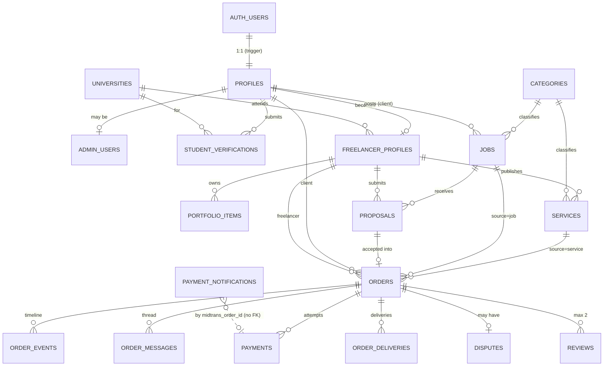
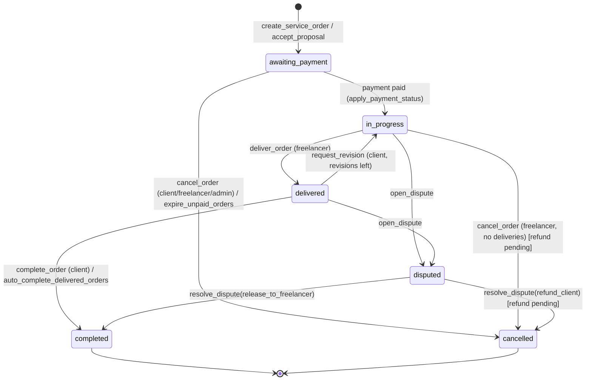
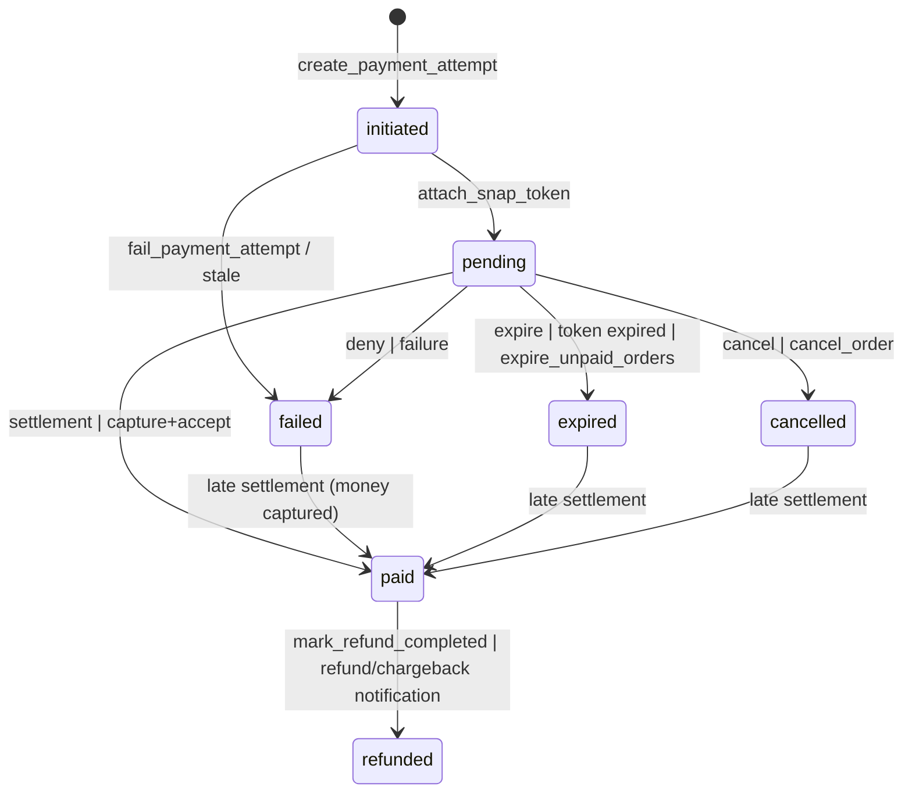
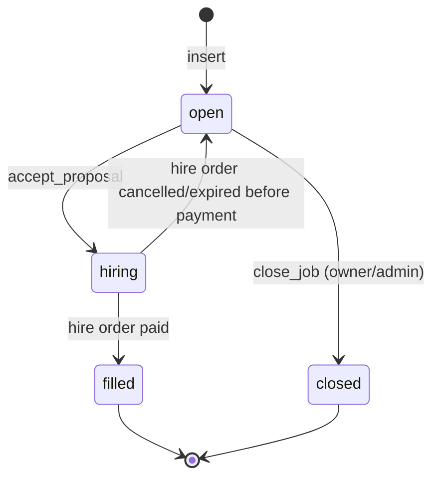

# Projekin — Database Design

| | |
|---|---|
| Status | Draft for approval |
| Version | 0.2 (2026-11-13), with product-owner decisions on Q1, Q3, Q6 and the database environment |
| Engine | Supabase PostgreSQL (15+), Supabase Auth, Supabase Storage, `pg_cron` |
| Related | [PRD.md](PRD.md) (business rules `BR-xx`), [API_CONTRACT.md](API_CONTRACT.md), [ARCHITECTURE.md](ARCHITECTURE.md) |

**Source-of-truth rule.** This document owns table, column, enum, function, policy and bucket **names**. Code and the other documents must use these names exactly. Numeric limits come from [PRD §5](PRD.md#5-business-rules). §6.4 lists where each one is encoded.

---

## 1. Conventions

- Schema `public` holds tables, views and API-callable RPC functions. Schema `private` holds helper functions used by RLS and RPCs. `private` is **not** exposed by the Supabase Data API.
- Primary keys are `uuid` with `default gen_random_uuid()`. The exceptions are append-only logs, which use `bigint generated always as identity`.
- Money columns are `bigint` (integer rupiah). Never use `numeric`/`float` for money.
- Timestamps are `timestamptz`, defaulting to `now()`. Every mutable table has `created_at` and `updated_at`. `updated_at` is maintained by the `private.set_updated_at()` trigger.
- Text limits are enforced with `CHECK (char_length(col) BETWEEN x AND y)`. Values are also validated server-side with Zod ([API_CONTRACT §2](API_CONTRACT.md#2-shared-schemas)).
- Foreign keys to user-owned business records use `ON DELETE RESTRICT` (orders, payments and reviews must never disappear). Profile-scoped content uses `ON DELETE CASCADE` (portfolio, verifications).
- Every table has RLS **enabled**. Tables without a policy for an operation deny that operation.
- State changes go through `SECURITY DEFINER` RPC functions with `SET search_path = ''` and fully qualified names (see §7). Direct table writes are limited to simple owner-scoped content and are protected by RLS and column-level grants.
- Errors raised by functions use custom SQLSTATEs (see §7.1).

---

## 2. Entity-relationship diagram



---

## 3. Enums

```sql
create type public.verification_method as enum ('email_domain', 'document');
create type public.verification_status as enum ('pending', 'approved', 'rejected');
create type public.freelancer_status   as enum ('active', 'suspended');
create type public.service_status      as enum ('draft', 'published', 'paused', 'archived');
create type public.job_status          as enum ('open', 'hiring', 'filled', 'closed');
create type public.proposal_status     as enum ('submitted', 'accepted', 'rejected', 'withdrawn');
create type public.order_source        as enum ('service', 'job');
create type public.order_status        as enum ('awaiting_payment', 'in_progress', 'delivered',
                                                'completed', 'cancelled', 'disputed');
create type public.payment_status      as enum ('initiated', 'pending', 'paid', 'failed',
                                                'expired', 'cancelled', 'refunded');
create type public.refund_status       as enum ('none', 'pending', 'refunded');
create type public.payout_status       as enum ('none', 'pending', 'paid');
create type public.dispute_status      as enum ('open', 'resolved');
create type public.dispute_resolution  as enum ('release_to_freelancer', 'refund_client');
create type public.review_role         as enum ('client', 'freelancer');  -- role of the REVIEWER

-- Account-level student verification state. DERIVED by
-- private.student_verification_state(uid); never stored, never client-writable (§8.6).
create type public.student_verification_state as enum ('unverified', 'pending', 'verified', 'rejected');
```

---

## 4. Tables

Notation: **PK** primary key, **FK** foreign key, **U** unique, **NN** not null. "Grant (upd)" marks columns that authenticated users may update directly (see §10).

### 4.1 `profiles`

One row per auth user, created by trigger `on_auth_user_created`.

| Column | Type | Constraints / notes |
|---|---|---|
| id | uuid | PK, FK → `auth.users(id)` ON DELETE CASCADE |
| username | text | NN, U, `CHECK (username ~ '^[a-z0-9_]{3,30}$')`. Generated as `user_<10 hex>` at sign-up (BR-28). Grant (upd) |
| full_name | text | `CHECK (char_length(full_name) BETWEEN 1 AND 100)`. Null until onboarding. Grant (upd) |
| avatar_path | text | Storage path in `avatars`. Grant (upd) |
| bio | text | `≤ 1000` chars. Grant (upd) |
| location | text | `≤ 100` chars. Grant (upd) |
| terms_accepted_at | timestamptz | Set by `complete_onboarding` |
| onboarded_at | timestamptz | Set by `complete_onboarding`. Null means not onboarded. |
| created_at, updated_at | timestamptz | NN |

Email is **not** stored here. It lives only in `auth.users` and is never publicly readable.

### 4.2 `admin_users`

| Column | Type | Constraints / notes |
|---|---|---|
| user_id | uuid | PK, FK → `profiles(id)` ON DELETE CASCADE |
| created_at | timestamptz | NN |

Written only by SQL/service role. Read only through `private.is_admin()`.

### 4.3 `universities`

| Column | Type | Constraints / notes |
|---|---|---|
| id | uuid | PK |
| name | text | NN, U |
| short_name | text | e.g. "UBT", "STMIK PPKIA" |
| email_domains | text[] | NN, default `'{}'`. Lower-case exact domains (e.g. `student.example.ac.id`). **Exact match only, no suffix matching.** |
| is_active | boolean | NN, default `true` |
| created_at, updated_at | timestamptz | NN |

### 4.4 `student_verifications`

Request and audit log. The current eligibility lives in `freelancer_profiles` (§4.5).

| Column | Type | Constraints / notes |
|---|---|---|
| id | uuid | PK |
| user_id | uuid | NN, FK → `profiles(id)` ON DELETE CASCADE |
| university_id | uuid | NN, FK → `universities(id)` |
| method | verification_method | NN |
| verified_email | text | Snapshot of the account email used (`email_domain` method only) |
| student_number | text | `≤ 50` chars. **Required when** `method = 'document'` |
| document_path | text | Path in `student-documents`. **Required when** `method = 'document'` |
| status | verification_status | NN, default `'pending'` |
| valid_until | timestamptz | **Required when** `status = 'approved'` |
| rejection_reason | text | **Required when** `status = 'rejected'`, `≤ 500` chars |
| reviewed_by | uuid | FK → `profiles(id)`. Null for automatic approval. |
| reviewed_at | timestamptz | |
| created_at | timestamptz | NN |

Constraints:
- `CHECK (method <> 'document' OR (student_number IS NOT NULL AND document_path IS NOT NULL))`
- `CHECK (status <> 'approved' OR valid_until IS NOT NULL)`
- `CHECK (status <> 'rejected' OR rejection_reason IS NOT NULL)`
- `CREATE UNIQUE INDEX ON student_verifications(user_id) WHERE status = 'pending'` (BR-04)

### 4.5 `freelancer_profiles`

Created or updated **only** by verification approval. This table is the single source of truth for freelancer eligibility (BR-01).

| Column | Type | Constraints / notes |
|---|---|---|
| user_id | uuid | PK, FK → `profiles(id)` ON DELETE CASCADE |
| university_id | uuid | NN, FK → `universities(id)`. System-managed. |
| verified_until | timestamptz | NN. System-managed. |
| status | freelancer_status | NN, default `'active'`. Admin-managed. |
| headline | text | `≤ 120` chars. Grant (upd) |
| skills | text[] | NN, default `'{}'`, `CHECK (cardinality(skills) <= 15)`. Each item 1–30 chars: `CHECK (private.skills_valid(skills))`. Grant (upd) |
| major | text | `≤ 100` chars. Grant (upd) |
| created_at, updated_at | timestamptz | NN |

### 4.6 `portfolio_items`

| Column | Type | Constraints / notes |
|---|---|---|
| id | uuid | PK |
| freelancer_id | uuid | NN, FK → `freelancer_profiles(user_id)` ON DELETE CASCADE |
| title | text | NN, 1–100 chars |
| description | text | `≤ 2000` chars |
| external_url | text | `CHECK (external_url ~ '^https://')`, ≤ 500 chars |
| image_paths | text[] | NN, default `'{}'`, `CHECK (cardinality(image_paths) <= 5)`. Paths in `portfolio` |
| sort_order | integer | NN, default 0 |
| created_at, updated_at | timestamptz | NN |

### 4.7 `categories`

| Column | Type | Constraints / notes |
|---|---|---|
| id | uuid | PK |
| slug | text | NN, U, `^[a-z0-9-]{2,50}$` |
| name | text | NN |
| sort_order | integer | NN, default 0 |
| is_active | boolean | NN, default true |

### 4.8 `services`

| Column | Type | Constraints / notes |
|---|---|---|
| id | uuid | PK |
| freelancer_id | uuid | NN, FK → `freelancer_profiles(user_id)` ON DELETE RESTRICT |
| category_id | uuid | NN, FK → `categories(id)`. Grant (upd) |
| title | text | NN, 10–100 chars. Grant (upd) |
| description | text | NN, 50–5000 chars. Grant (upd) |
| price | bigint | NN, `CHECK (price BETWEEN 10000 AND 50000000)` (BR-07). Grant (upd) |
| delivery_days | smallint | NN, `CHECK (delivery_days BETWEEN 1 AND 60)` (BR-08). Grant (upd) |
| revisions_included | smallint | NN, `CHECK (revisions_included BETWEEN 0 AND 5)` (BR-08). Grant (upd) |
| requirements_prompt | text | `≤ 1000` chars. Grant (upd) |
| cover_image_path | text | Path in `service-media`. Required to publish. Grant (upd) |
| status | service_status | NN, default `'draft'`. Changed via `set_service_status` only. |
| published_at | timestamptz | First publish time |
| blocked_at | timestamptz | Admin block. Non-null means hidden and not publishable. |
| blocked_reason | text | `≤ 500` chars |
| search | tsvector | `GENERATED ALWAYS AS (setweight(to_tsvector('simple', coalesce(title,'')),'A') \|\| setweight(to_tsvector('simple', coalesce(description,'')),'B')) STORED` |
| created_at, updated_at | timestamptz | NN |

The `'simple'` text-search config is used because Postgres has no built-in Indonesian config and listings mix Indonesian and English.

### 4.9 `jobs`

| Column | Type | Constraints / notes |
|---|---|---|
| id | uuid | PK |
| client_id | uuid | NN, FK → `profiles(id)` ON DELETE RESTRICT |
| category_id | uuid | NN, FK → `categories(id)`. Grant (upd) |
| title | text | NN, 10–100 chars. Grant (upd) |
| description | text | NN, 50–5000 chars. Grant (upd) |
| budget_min | bigint | NN, BR-07 range. Grant (upd) |
| budget_max | bigint | NN, BR-07 range, `CHECK (budget_min <= budget_max)`. Grant (upd) |
| requirements | text | Optional, `≤ 3000` chars. Copied to the order on hire. Grant (upd) |
| deadline | date | Nullable. Must be `>=` today (Asia/Jakarta) on insert/update (RLS `WITH CHECK`, `private.today_jakarta()`). Grant (upd) |
| status | job_status | NN, default `'open'`. Changed via RPC only. |
| closed_at | timestamptz | |
| closed_reason | text | Optional reason given in `close_job`, `≤ 500` chars |
| search | tsvector | Generated, same as services |
| created_at, updated_at | timestamptz | NN |

### 4.10 `proposals`

| Column | Type | Constraints / notes |
|---|---|---|
| id | uuid | PK |
| job_id | uuid | NN, FK → `jobs(id)` ON DELETE RESTRICT |
| freelancer_id | uuid | NN, FK → `freelancer_profiles(user_id)` ON DELETE RESTRICT |
| cover_letter | text | NN, 50–3000 chars |
| price | bigint | NN, BR-07 range |
| delivery_days | smallint | NN, 1–60 |
| revisions_included | smallint | NN, 0–5 |
| status | proposal_status | NN, default `'submitted'` |
| status_reason | text | e.g. `job_closed`, `job_filled`, `hire_cancelled`, or the client's reason (≤ 500 chars) |
| decided_at | timestamptz | When the status left `submitted` |
| created_at, updated_at | timestamptz | NN |

Constraints: `UNIQUE (job_id, freelancer_id)` (BR-14).

### 4.11 `orders`

The unified order for both flows.

| Column | Type | Constraints / notes |
|---|---|---|
| id | uuid | PK |
| order_number | bigint | NN, U, `GENERATED ALWAYS AS IDENTITY`. Displayed as `PJK-` + zero-padded 6 digits (formatted in app code). |
| source | order_source | NN |
| service_id | uuid | FK → `services(id)` ON DELETE RESTRICT |
| job_id | uuid | FK → `jobs(id)` ON DELETE RESTRICT |
| proposal_id | uuid | U, FK → `proposals(id)` ON DELETE RESTRICT |
| client_id | uuid | NN, FK → `profiles(id)` ON DELETE RESTRICT |
| freelancer_id | uuid | NN, FK → `freelancer_profiles(user_id)` ON DELETE RESTRICT |
| title | text | NN. Snapshot of service or job title. |
| brief | text | NN. Snapshot of service description or job description. |
| requirements | text | Service orders: the client's requirements (10–5000 chars, set by `create_service_order`). Job orders: copied from `jobs.requirements` (may be null). |
| amount | bigint | NN, BR-07 range. Price the client pays (BR-09). |
| platform_fee | bigint | NN, `>= 0` |
| freelancer_earnings | bigint | NN, `>= 0` |
| delivery_days | smallint | NN, 1–60 (snapshot) |
| revisions_allowed | smallint | NN, 0–5 (snapshot) |
| revisions_used | smallint | NN, default 0 |
| status | order_status | NN, default `'awaiting_payment'` |
| payment_due_at | timestamptz | NN. `created_at + 24h` (BR-10) |
| paid_at | timestamptz | |
| due_at | timestamptz | `paid_at + delivery_days` (BR-17) |
| delivered_at | timestamptz | Time of the **latest** delivery (drives BR-18) |
| completed_at | timestamptz | |
| cancelled_at | timestamptz | |
| cancelled_by | uuid | FK → `profiles(id)`. Null means system. |
| cancellation_reason | text | `≤ 500` chars |
| payout_status | payout_status | NN, default `'none'` |
| payout_reference | text | `≤ 200` chars |
| payout_marked_by | uuid | FK → `profiles(id)` |
| payout_marked_at | timestamptz | |
| created_at, updated_at | timestamptz | NN |

Constraints:
- `CHECK (client_id <> freelancer_id)` (BR-06)
- `CHECK (amount = platform_fee + freelancer_earnings)`
- `CHECK (revisions_used BETWEEN 0 AND revisions_allowed)`
- `CHECK ((source = 'service' AND service_id IS NOT NULL AND job_id IS NULL AND proposal_id IS NULL) OR (source = 'job' AND job_id IS NOT NULL AND proposal_id IS NOT NULL AND service_id IS NULL))`
- `CREATE UNIQUE INDEX orders_one_live_order_per_job ON orders(job_id) WHERE job_id IS NOT NULL AND status <> 'cancelled'` (BR-16)
- `CHECK (payout_status = 'none' OR status = 'completed')`

The platform fee is not confidential. Both parties can read the row, and the UI decides what to emphasise.

### 4.12 `order_events` (append-only)

| Column | Type | Constraints / notes |
|---|---|---|
| id | bigint | PK, identity |
| order_id | uuid | NN, FK → `orders(id)` ON DELETE RESTRICT |
| actor_id | uuid | FK → `profiles(id)`. Null means system (webhook or cron). |
| event_type | text | NN, one of the values below |
| from_status | order_status | |
| to_status | order_status | |
| payload | jsonb | NN, default `'{}'` (e.g. `{ "message": "..." }` for revision requests, `{ "midtrans_order_id": "..." }`) |
| created_at | timestamptz | NN |

`event_type` values: `created`, `payment_attempt_created`, `payment_paid`, `payment_failed`, `payment_expired`, `payment_cancelled`, `late_payment_detected`, `duplicate_payment_detected`, `delivered`, `revision_requested`, `completed`, `auto_completed`, `cancelled`, `dispute_opened`, `dispute_resolved`, `refund_marked`, `payment_refunded_by_provider`, `payout_marked`. Enforced with `CHECK (event_type IN (...))`.

### 4.13 `order_messages`

| Column | Type | Constraints / notes |
|---|---|---|
| id | uuid | PK |
| order_id | uuid | NN, FK → `orders(id)` ON DELETE RESTRICT |
| sender_id | uuid | NN, FK → `profiles(id)` |
| body | text | NN, 1–5000 chars (BR-29) |
| created_at | timestamptz | NN |

Messages are immutable (no update or delete).

### 4.14 `order_deliveries`

| Column | Type | Constraints / notes |
|---|---|---|
| id | uuid | PK |
| order_id | uuid | NN, FK → `orders(id)` ON DELETE RESTRICT |
| freelancer_id | uuid | NN, FK → `freelancer_profiles(user_id)` |
| delivery_number | smallint | NN. 1-based per order. `UNIQUE (order_id, delivery_number)` |
| message | text | NN, 1–5000 chars |
| attachment_paths | text[] | NN, default `'{}'`, `CHECK (cardinality(attachment_paths) <= 10)`. Paths in `order-files` |
| created_at | timestamptz | NN |

### 4.15 `disputes`

| Column | Type | Constraints / notes |
|---|---|---|
| id | uuid | PK |
| order_id | uuid | NN, **U**, FK → `orders(id)` ON DELETE RESTRICT. One dispute per order. |
| opened_by | uuid | NN, FK → `profiles(id)` |
| reason | text | NN, 20–2000 chars |
| status | dispute_status | NN, default `'open'` |
| resolution | dispute_resolution | Required when resolved |
| admin_note | text | Required when resolved, 1–2000 chars |
| resolved_by | uuid | FK → `profiles(id)` |
| resolved_at | timestamptz | |
| created_at | timestamptz | NN |

`CHECK (status = 'open' OR (resolution IS NOT NULL AND admin_note IS NOT NULL AND resolved_by IS NOT NULL))`

### 4.16 `payments`

One row per Midtrans Snap transaction attempt.

| Column | Type | Constraints / notes |
|---|---|---|
| id | uuid | PK |
| order_id | uuid | NN, FK → `orders(id)` ON DELETE RESTRICT |
| attempt_no | smallint | NN, `CHECK (attempt_no BETWEEN 1 AND 5)` (BR-11). `UNIQUE (order_id, attempt_no)` |
| midtrans_order_id | text | NN, **U**. Format `PJK-{order_number:06}-{attempt_no}-{first 8 hex of id}`, e.g. `PJK-000123-1-a1b2c3d4`. The random suffix keeps IDs unique across environments that share one sandbox merchant. |
| gross_amount | bigint | NN. Equal to `orders.amount` at creation. |
| status | payment_status | NN, default `'initiated'` |
| snap_token | text | Set by `attach_snap_token` |
| snap_redirect_url | text | |
| token_expires_at | timestamptz | Equal to the Snap `expiry` end, which is ≤ `orders.payment_due_at` |
| midtrans_transaction_id | text | |
| midtrans_transaction_status | text | Raw last-known value (e.g. `settlement`) |
| midtrans_fraud_status | text | |
| midtrans_status_code | text | |
| payment_type | text | e.g. `bank_transfer`, `gopay`, `credit_card` |
| paid_at | timestamptz | |
| failure_reason | text | `≤ 500` chars |
| refund_status | refund_status | NN, default `'none'` |
| refund_reference | text | `≤ 200` chars |
| refund_marked_by | uuid | FK → `profiles(id)` |
| refund_marked_at | timestamptz | |
| last_synced_at | timestamptz | Last Status API sync |
| created_at, updated_at | timestamptz | NN |

Constraints: `CREATE UNIQUE INDEX payments_one_live_attempt ON payments(order_id) WHERE status IN ('initiated', 'pending')`.

### 4.17 `payment_notifications` (append-only, admin-readable)

| Column | Type | Constraints / notes |
|---|---|---|
| id | bigint | PK, identity |
| midtrans_order_id | text | Nullable (malformed payloads) |
| transaction_status | text | |
| status_code | text | |
| signature_valid | boolean | NN |
| payload | jsonb | NN. Notification body **without** `signature_key` (signature values are never stored or logged). |
| processing_result | text | `applied`, `no_change`, `ignored_regression`, `unknown_payment`, `amount_mismatch`, `invalid_signature`, `not_found` (signed, but the Status API has no such transaction), `error` |
| error | text | |
| received_at | timestamptz | NN |
| processed_at | timestamptz | |

No FK to `payments`. Notifications for unknown IDs (for example, from another environment) are still logged.

### 4.18 `reviews`

| Column | Type | Constraints / notes |
|---|---|---|
| id | uuid | PK |
| order_id | uuid | NN, FK → `orders(id)` ON DELETE RESTRICT |
| reviewer_id | uuid | NN, FK → `profiles(id)` |
| reviewee_id | uuid | NN, FK → `profiles(id)` |
| reviewer_role | review_role | NN. `client` means a review **of the freelancer**. |
| service_id | uuid | FK → `services(id)`. Copied from the order (service orders, client reviews only). |
| rating | smallint | NN, `CHECK (rating BETWEEN 1 AND 5)` |
| comment | text | `≤ 2000` chars |
| created_at | timestamptz | NN |

Constraints: `UNIQUE (order_id, reviewer_id)` and `CHECK (reviewer_id <> reviewee_id)`.

### 4.19 Views (all `WITH (security_invoker = true)`)

| View | Definition |
|---|---|
| `freelancer_rating_stats` | `reviewee_id AS user_id, round(avg(rating),2) AS rating_avg, count(*) AS rating_count FROM reviews WHERE reviewer_role = 'client' GROUP BY reviewee_id` |
| `client_rating_stats` | Same as above, with `reviewer_role = 'freelancer'` |
| `service_rating_stats` | `service_id, round(avg(rating),2), count(*) FROM reviews WHERE reviewer_role = 'client' AND service_id IS NOT NULL GROUP BY service_id` |

| `service_listings` | `services` + `freelancer_profiles` (university_id) + `universities.short_name` + `profiles` (username, full_name, avatar_path) + `service_rating_stats` (rating_avg, rating_count, default 0). One row per service, including `search`. Used by `/services` so that `sort=rating` is a plain `ORDER BY`. |

`reviews` is publicly readable, so the rating views expose nothing extra. `service_listings` is `security_invoker`, so the `services` RLS policy still decides which rows are visible.

As implemented: the three rating views were added in `20261114010000` (`rating_count` is an `integer`), together with the `SELECT` grant on `reviews` to `anon` that `20261114000000` had left out. `service_listings` gained `rating_avg` and `rating_count` (0 when unrated) as its last columns; it does not include `search` (`/services` matches title and description with `ilike`).

---

## 5. Indexes

| Table | Index |
|---|---|
| student_verifications | `(user_id, created_at desc)`, partial unique `(user_id) WHERE status='pending'`, `(status, created_at) WHERE status='pending'` (admin queue) |
| portfolio_items | `(freelancer_id, sort_order)` |
| services | `(freelancer_id)`, `(category_id, status)`, `(status, published_at desc)`, `(price)`, GIN `(search)` |
| jobs | `(client_id, created_at desc)`, `(status, created_at desc)`, `(category_id, status)`, GIN `(search)` |
| proposals | `(job_id, status)`, `(freelancer_id, created_at desc)`, unique `(job_id, freelancer_id)` |
| orders | `(client_id, status, created_at desc)`, `(freelancer_id, status, created_at desc)`, `(status, payment_due_at) WHERE status='awaiting_payment'`, `(status, delivered_at) WHERE status='delivered'`, `(payout_status) WHERE payout_status='pending'`, partial unique on `job_id` (§4.11) |
| order_events | `(order_id, created_at)` |
| order_messages | `(order_id, created_at)` |
| order_deliveries | `(order_id, delivery_number)` unique |
| payments | unique `(midtrans_order_id)`, unique `(order_id, attempt_no)`, partial unique live attempt, `(refund_status) WHERE refund_status='pending'`, `(status, created_at) WHERE status IN ('initiated','pending')` (reconciliation) |
| payment_notifications | `(midtrans_order_id, received_at desc)` |
| reviews | `(reviewee_id, reviewer_role, created_at desc)`, `(service_id) WHERE service_id IS NOT NULL`, unique `(order_id, reviewer_id)` |

---

## 6. Helper functions (`private` schema)

All helpers are `LANGUAGE sql STABLE SECURITY DEFINER SET search_path = ''`. They are granted `EXECUTE` to `anon` and `authenticated` (needed so RLS policies can call them), and `USAGE ON SCHEMA private` is granted to the same roles. Because `private` is not an exposed API schema, they cannot be called through PostgREST.

### 6.1 Identity

| Function | Returns | Logic |
|---|---|---|
| `private.is_admin()` | boolean | `EXISTS (SELECT 1 FROM public.admin_users WHERE user_id = auth.uid())` |
| `private.is_onboarded(uid uuid)` | boolean | `profiles.onboarded_at IS NOT NULL` |
| `private.is_eligible_freelancer(uid uuid)` | boolean | `EXISTS (freelancer_profiles WHERE user_id = uid AND status = 'active' AND verified_until > now())` (BR-01) |
| `private.student_verification_state(uid uuid)` | student_verification_state | §8.6 mapping. **Not** granted to API roles; exposed only for the caller through `get_my_verification_status()`. |
| `private.apply_verification_approval(uid, university_id, valid_until)` | void | Upserts `freelancer_profiles` (`verified_until = greatest(existing, new)`). Called only from the verification RPCs. **Not** granted to API roles. |

### 6.2 Relationship helpers (avoid RLS recursion)

Policies on `jobs` reference `proposals` and the other way round. Inlined subqueries would trigger infinite RLS recursion, so these `SECURITY DEFINER` helpers bypass RLS for the lookup only.

| Function | Logic |
|---|---|
| `private.is_job_owner(p_job_id uuid)` | `jobs.client_id = auth.uid()` |
| `private.has_proposal_on_job(p_job_id uuid)` | proposal exists with `freelancer_id = auth.uid()` |
| `private.job_has_proposals(p_job_id uuid)` | any proposal exists for the job |
| `private.active_job_count(uid uuid)` | count of jobs with `client_id = uid AND status IN ('open','hiring')` |
| `private.is_order_participant(p_order_id uuid)` | `auth.uid() IN (client_id, freelancer_id)` |
| `private.is_order_client(p_order_id uuid)` | `orders.client_id = auth.uid()` |
| `private.order_accepts_messages(p_order_id uuid)` | `orders.status IN ('in_progress','delivered','disputed')` (BR-29) |
| `private.skills_valid(p_skills text[])` | `IMMUTABLE`, not `SECURITY DEFINER`. True if every element has 1–30 characters. Used by the `freelancer_profiles.skills` CHECK. |
| `private.can_upload_order_file(object_name text)` | Parses `{order_id}/{uid}/...` safely (returns false on a malformed UUID). True if the second segment is `auth.uid()`, the user is a participant, and the order accepts messages. |

### 6.3 Triggers

| Function | Trigger |
|---|---|
| `private.handle_new_user()` | `AFTER INSERT ON auth.users`. Inserts `profiles(id, username)` with `username = 'user_' \|\| left(replace(id::text,'-',''),10)`. |
| `private.set_updated_at()` | `BEFORE UPDATE` on every table with `updated_at` |

### 6.4 Business constants

Constants live in `IMMUTABLE` SQL functions, so changing them is a reviewed migration. Each maps to a PRD rule.

| Function | Value | Rule |
|---|---|---|
| `private.platform_fee_bps()` | `1000` (10%) | BR-09 |
| `private.payment_window()` | `interval '24 hours'` | BR-10 |
| `private.payment_grace()` | `interval '15 minutes'` | BR-10 |
| `private.max_payment_attempts()` | `5` | BR-11 |
| `private.max_awaiting_payment_orders()` | `5` | BR-12 |
| `private.max_active_jobs()` | `10` | BR-13 |
| `private.max_proposals_per_day()` | `30` | BR-14 |
| `private.max_published_services()` | `20` | BR-15 |
| `private.auto_complete_after()` | `interval '3 days'` | BR-18 |
| `private.review_window()` | `interval '14 days'` | BR-22 |
| `private.verification_default_validity()` | `interval '12 months'` | BR-03 |
| `private.verification_max_validity()` | `interval '24 months'` | BR-03 |
| `private.verification_renewal_window()` | `interval '30 days'` | FR-VER-05 |

Static limits (price range BR-07, delivery days and revisions BR-08, text lengths) are `CHECK` constraints and are mirrored in Zod schemas ([API_CONTRACT §2](API_CONTRACT.md#2-shared-schemas)).

---

## 7. RPC functions (`public` schema)

All are `LANGUAGE plpgsql SECURITY DEFINER SET search_path = ''`. Each one:

1. Checks `auth.uid()` is not null (unless service-role-only).
2. Checks the caller's role or ownership.
3. Locks affected rows with `SELECT ... FOR UPDATE` in the **global lock order: `jobs` → `proposals` → `orders` → `payments`**, to prevent deadlocks. Every function that touches a job-flow order locks the `jobs` row first, which serialises all transitions for that job.
4. Validates current state and inputs.
5. Writes all changes, plus an `order_events` row for order-related changes.
6. Returns the result.

`EXECUTE` is revoked from `public` and `anon` and granted explicitly per the "Callable by" column.

### 7.1 Error codes

| SQLSTATE | Meaning | Mapped app code ([API_CONTRACT §1.3](API_CONTRACT.md#13-error-codes)) |
|---|---|---|
| `PJ401` | Not authenticated | `UNAUTHENTICATED` |
| `PJ403` | Authenticated but not allowed (includes "not onboarded" and "not eligible freelancer") | `FORBIDDEN` |
| `PJ404` | Row not found or not visible to the caller | `NOT_FOUND` |
| `PJ409` | Invalid state transition, or a uniqueness or limit conflict | `INVALID_STATE` / `CONFLICT` / `LIMIT_REACHED` |
| `PJ422` | Invalid input | `VALIDATION_ERROR` |

The `MESSAGE` is a stable machine-readable reason (e.g. `ORDER_NOT_AWAITING_PAYMENT`, `MAX_PAYMENT_ATTEMPTS`). `DETAIL` may carry a human-readable explanation. A Postgres `23505` (unique violation) raised inside a function maps to `CONFLICT`.

### 7.2 Function catalogue

**Callable by:** **A** = `authenticated` (function checks the role internally), **S** = `service_role` only, **C** = `pg_cron` (runs as `postgres`) and also S.

| Function | By | Preconditions → effects |
|---|---|---|
| `complete_onboarding(p_full_name text, p_username text, p_accept_terms boolean) → profiles` | A | `p_accept_terms = true`. Username valid and free → sets `full_name`, `username`, `terms_accepted_at`, `onboarded_at`. Idempotent: it can update name or username again later, and `onboarded_at` keeps its first value. |
| `get_my_verification_status() → table(state, is_suspended, verified_until, university_id, latest_request_id, latest_request_status, latest_rejection_reason, can_submit)` | A | Caller's own account-level state (§8.6) plus the data the verification page needs. `can_submit` = onboarded, no pending request, and not verified beyond the renewal window. |
| `submit_student_verification(p_university_id uuid, p_method verification_method, p_student_number text DEFAULT NULL, p_document_path text DEFAULT NULL) → student_verifications` | A | Onboarded. No pending request (BR-04, else `PJ409 VERIFICATION_PENDING`). Not currently verified beyond the renewal window (`verified_until > now() + renewal_window` → `PJ409 ALREADY_VERIFIED`). University active. **email_domain:** reads `auth.users.email` and `email_confirmed_at` for `auth.uid()`. If confirmed and `lower(split_part(email,'@',2)) = ANY(email_domains)`, inserts an `approved` row with `valid_until = now() + default_validity` and upserts `freelancer_profiles` (`university_id`, `verified_until = greatest(existing, new)`, status unchanged if the row exists). Otherwise `PJ422 EMAIL_DOMAIN_NOT_ELIGIBLE`. **document:** requires `student_number` and a `document_path` that starts with `auth.uid() || '/'` and exists in `storage.objects` (bucket `student-documents`) → inserts `pending`. |
| `review_student_verification(p_verification_id uuid, p_decision text, p_valid_until timestamptz DEFAULT NULL, p_reason text DEFAULT NULL) → student_verifications` | A (admin) | `is_admin()`. Reviewer is not the requester (`PJ403 CANNOT_REVIEW_OWN`). Row is `pending` (`PJ409 NOT_PENDING`). `p_decision IN ('approve','reject')`. **approve:** `now() < p_valid_until <= now() + max_validity` → `approved`, plus upsert `freelancer_profiles` as above. **reject:** `p_reason` required → `rejected`. Sets `reviewed_by` and `reviewed_at`. |
| `set_freelancer_status(p_user_id uuid, p_status freelancer_status) → freelancer_profiles` | A (admin) | Updates status (`PJ403 CANNOT_MODERATE_SELF` for the caller's own row). Suspension hides services through RLS (BR-05). Implemented in `080900` (Copilot). |
| `set_service_status(p_service_id uuid, p_status service_status) → services` | A (owner) | Allowed transitions: `draft→published`, `paused→published`, `published→paused`, `draft\|published\|paused→archived`. Publishing requires `is_eligible_freelancer(auth.uid())`, `blocked_at IS NULL`, `cover_image_path IS NOT NULL`, and published count < `max_published_services()`. Sets `published_at` on first publish. |
| `admin_set_service_block(p_service_id uuid, p_blocked boolean, p_reason text DEFAULT NULL) → services` | A (admin) | Block: sets `blocked_at` and `blocked_reason` (reason required), and moves `published` to `paused`. Unblock: clears both. Status stays paused. |
| `close_job(p_job_id uuid, p_reason text DEFAULT NULL) → jobs` | A (owner or admin) | Job `open` → `closed`, `closed_at`. All `submitted` proposals → `rejected` (`status_reason = 'job_closed'`). |
| `submit_proposal(p_job_id uuid, p_cover_letter text, p_price bigint, p_delivery_days integer, p_revisions_included integer) → proposals` | A | Onboarded and eligible freelancer (BR-01). Job `open`. `client_id <> auth.uid()` (BR-06). Proposals by caller in the last 24h < `max_proposals_per_day()` (BR-14) → inserts `submitted`. Unique violation → `CONFLICT ALREADY_PROPOSED`. |
|  | | Locks the job `FOR SHARE`, so a concurrent `close_job`/`accept_proposal` (`FOR UPDATE`) cannot interleave. |
| `withdraw_proposal(p_proposal_id uuid) → proposals` | A (proposal owner) | `submitted` → `withdrawn`, `decided_at`. |
| `reject_proposal(p_proposal_id uuid, p_reason text DEFAULT NULL) → proposals` | A (job owner) | `submitted` → `rejected`. |
| `accept_proposal(p_proposal_id uuid) → uuid` (order id) | A (job owner) | Locks job, proposal. Job `open`. Proposal `submitted`. Freelancer still eligible (`PJ403 FREELANCER_NOT_ELIGIBLE`). Caller's `awaiting_payment` orders < `max_awaiting_payment_orders()` (BR-12) → proposal `accepted`, job `hiring`, insert order (`source='job'`, terms from proposal, `title`/`brief` from job, amounts per BR-09, `payment_due_at = now() + payment_window()`), event `created`. |
| `create_service_order(p_service_id uuid, p_requirements text) → uuid` (order id) | A | Onboarded. Requirements 10–5000 chars (`PJ422 INVALID_REQUIREMENTS`). Service exists (`PJ404 SERVICE_NOT_FOUND`), `freelancer_id <> auth.uid()` (`PJ403 OWN_SERVICE`, BR-06), `published`, not blocked and freelancer eligible (else `PJ409 SERVICE_NOT_AVAILABLE`). No other `awaiting_payment` order by this client for the same service (`PJ409 SERVICE_ORDER_PENDING`, prevents duplicate orders from double submits). BR-12 limit → insert order (`source='service'`, snapshot of service terms, amounts per BR-09), event `created`. A per-client transaction advisory lock (also taken by `accept_proposal`) serialises the BR-12 count and the duplicate check. |
| `create_payment_attempt(p_order_id uuid) → payments` | A (order client) | Locks order. Status `awaiting_payment`. `now() < payment_due_at - interval '5 minutes'` (else `PJ409 PAYMENT_WINDOW_CLOSING`). If a live attempt exists: **(a)** it has `snap_token` and `token_expires_at > now()` → return it unchanged (reuse, BR-11); **(b)** it is `initiated` without a token and < 2 min old → `PJ409 PAYMENT_IN_PROGRESS`; **(c)** otherwise mark it `failed` (stale `initiated`) or `expired` (`pending` with an expired token). Then if attempt count ≥ `max_payment_attempts()` → `PJ409 MAX_PAYMENT_ATTEMPTS`. Insert a new `initiated` attempt (`gross_amount = orders.amount`, `midtrans_order_id` per §4.16), event `payment_attempt_created`. |
| `attach_snap_token(p_payment_id uuid, p_snap_token text, p_redirect_url text, p_token_expires_at timestamptz) → payments` | S | `initiated` (or `pending` without a token, if a notification arrived first) → `pending` with token fields. `p_token_expires_at <= orders.payment_due_at` (`PJ422 INVALID_TOKEN_EXPIRY`). Other statuses → `PJ409 PAYMENT_NOT_INITIATED`. |
| `fail_payment_attempt(p_payment_id uuid, p_reason text) → payments` | S | `initiated` → `failed` (Snap API call failed, or stale), event `payment_failed`. Idempotent for an already `failed` attempt; other statuses → `PJ409 PAYMENT_NOT_INITIATED`. |
| `apply_payment_status(p_midtrans_order_id text, p_transaction_status text, p_fraud_status text, p_status_code text, p_gross_amount bigint, p_payment_type text, p_transaction_id text) → text` | S | See §8.2. Returns a `processing_result` value. Idempotent. |
| `cancel_order(p_order_id uuid, p_reason text) → text[]` (`midtrans_order_id`s of attempts that were live) | A | **Client, freelancer or admin:** status `awaiting_payment`. **Freelancer:** also status `in_progress` with no `order_deliveries` row (BR-20). Effects: order `cancelled`, `cancelled_at`, `cancelled_by`, reason. Live attempts → `cancelled`. If a `paid` payment exists, its `refund_status` → `pending` (BR-24). Job orders cancelled **before payment**: job `hiring` → `open`, proposal → `rejected` (`hire_cancelled`). Job orders cancelled **after payment**: job stays `filled`. Event `cancelled`. |
|  | | Fully implemented in `081000` (replaces the pre-payment-only version from `080800`). Empty reason → `PJ422 INVALID_CANCEL_REASON`. Shared effects live in `private.apply_order_cancellation`, which `expire_unpaid_orders` also uses. |
| `deliver_order(p_order_id uuid, p_message text, p_attachment_paths text[] DEFAULT '{}') → order_deliveries` | A (freelancer; implemented in `081000`; the `order-files` bucket and upload UI arrive in Phase 7, so until then only message-only deliveries pass) | Status `in_progress`. ≤ 10 paths. Each path starts with `p_order_id || '/' || auth.uid() || '/'` and exists in `storage.objects` (bucket `order-files`) → inserts delivery (`delivery_number` = count + 1). Order → `delivered`, `delivered_at = now()`. Event `delivered`. |
| `request_revision(p_order_id uuid, p_message text) → orders` | A (client) | Status `delivered`. `revisions_used < revisions_allowed` (else `PJ409 NO_REVISIONS_LEFT`). Message 1–5000 chars → `in_progress`, `revisions_used + 1`. Event `revision_requested` with `{message}`. |
| `complete_order(p_order_id uuid) → orders` | A (client; implemented in `081000`) | Status `delivered` → `completed`, `completed_at`, `payout_status = 'pending'`. Event `completed`. Freelancer → `PJ403 NOT_ORDER_CLIENT`. |
| `open_dispute(p_order_id uuid, p_reason text) → disputes` | A (participant) | Status `in_progress` or `delivered`. No existing dispute → insert dispute. Order → `disputed`. Event `dispute_opened`. |
| `resolve_dispute(p_dispute_id uuid, p_resolution dispute_resolution, p_admin_note text) → disputes` | A (admin) | Dispute `open`, order `disputed`. **release_to_freelancer:** order `completed`, `completed_at`, `payout_status='pending'`. **refund_client:** order `cancelled` (`cancelled_by = admin`), paid payment `refund_status='pending'`. Dispute `resolved`. Event `dispute_resolved`. |
| `submit_review(p_order_id uuid, p_rating smallint, p_comment text DEFAULT NULL) → reviews` | A (participant) | Order `completed`. `now() <= completed_at + review_window()`. Derives `reviewer_role` and `reviewee_id`. Sets `service_id` when `source='service'` and the reviewer is the client. Unique violation → `CONFLICT ALREADY_REVIEWED`. |
| `mark_refund_completed(p_payment_id uuid, p_reference text) → payments` | A (admin) | `refund_status = 'pending'` → `refunded`, `status = 'refunded'`, reference, marker. Event `refund_marked`. |
| `mark_payout_paid(p_order_id uuid, p_reference text) → orders` | A (admin) | Order `completed`, `payout_status='pending'` → `paid`, reference, marker. Event `payout_marked`. |
| `expire_unpaid_orders() → integer` | C | For orders `awaiting_payment` with `payment_due_at + payment_grace() < now()`: same effects as a pre-payment `cancel_order` with `cancelled_by = NULL`, `cancellation_reason = 'payment_window_expired'`. Live attempts → `expired`. Rows locked by a concurrent payment or cancellation are skipped (`FOR UPDATE SKIP LOCKED`) until the next run. Returns count. |
| `auto_complete_delivered_orders() → integer` | C | For orders `delivered` with `delivered_at + auto_complete_after() < now()`: → `completed`, `payout_status='pending'`, event `auto_completed`. Returns count. |

**Phase 9 (`20261114020000`)** implements `resolve_dispute`, `mark_refund_completed` and `mark_payout_paid` as specified above. A refund decision reuses the cancellation helper (order `cancelled`, `cancellation_reason = 'dispute_refund'`, paid payment `refund_status = 'pending'`). New reasons: `INVALID_RESOLUTION`, `INVALID_ADMIN_NOTE`, `DISPUTE_NOT_FOUND`, `DISPUTE_NOT_OPEN`, `INVALID_REFERENCE`, `REFUND_NOT_PENDING`, `PAYOUT_NOT_PENDING`.

**Implemented names (Phases 7–8, `20261114000000`, corrected in `20261114010000`).** `request_revision` is `request_order_revision(p_order_id, p_reason)` (reason 10–2.000 characters, also posted to the thread; `NO_REVISIONS_REMAINING`). `open_dispute` is `open_order_dispute(p_order_id, p_reason)`. `submit_review` is `create_order_review(p_order_id, p_rating smallint, p_comment)` (a NULL rating → `PJ422 INVALID_RATING`; non-completed or older than 14 days → `PJ409 REVIEW_WINDOW_CLOSED`). Order messages are written only through `send_order_message(p_order_id, p_body)`: the two parties or an admin, while the order is `in_progress`, `delivered` or `disputed` (`MESSAGES_NOT_AVAILABLE` before payment, `MESSAGES_CLOSED` after completion or cancellation). `auto_complete_delivered_orders` runs every 15 minutes. `resolve_dispute`, `mark_refund_completed` and `mark_payout_paid` arrive in Phase 9.

**Direct table writes** (not via RPC) are limited to: `profiles` (granted columns), `freelancer_profiles` (granted columns), `portfolio_items`, `services` (insert/update granted columns, delete drafts), `jobs` (insert, update granted columns while editable), and `order_messages` (insert). The rest go through RPCs.

---

## 8. State machines

### 8.1 Order



| From | To | Actor | Function | Side effects |
|---|---|---|---|---|
| — | awaiting_payment | client | `create_service_order` / `accept_proposal` | `payment_due_at`. Job → `hiring` (job flow). |
| awaiting_payment | in_progress | system | `apply_payment_status` | `paid_at`, `due_at`. Job → `filled`. Other proposals → `rejected`. |
| awaiting_payment | cancelled | client, freelancer, admin, system | `cancel_order`, `expire_unpaid_orders` | Live attempts closed. Job → `open`. Accepted proposal → `rejected`. |
| in_progress | delivered | freelancer | `deliver_order` | `delivered_at` |
| in_progress | cancelled | freelancer | `cancel_order` | Refund pending. Job stays `filled`. |
| delivered | in_progress | client | `request_revision` | `revisions_used + 1` |
| delivered | completed | client, system | `complete_order`, `auto_complete_delivered_orders` | Payout pending |
| in_progress, delivered | disputed | either party | `open_dispute` | Dispute row |
| disputed | completed | admin | `resolve_dispute` | Payout pending |
| disputed | cancelled | admin | `resolve_dispute` | Refund pending |

`completed` and `cancelled` are terminal. Admin cannot otherwise force transitions in the MVP.

### 8.2 Payment attempt and `apply_payment_status`



**Mapping from Midtrans `transaction_status` (+ `fraud_status`) to `payment_status`:**

| Midtrans | → payment_status |
|---|---|
| `settlement` | `paid` |
| `capture` + `fraud_status = accept` (or null) | `paid` |
| `capture` + `fraud_status = challenge` | `pending` |
| `capture` + `fraud_status = deny` | `failed` |
| `authorize`, `pending` | `pending` |
| `deny`, `failure` | `failed` |
| `cancel` | `cancelled` |
| `expire` | `expired` |
| `refund`, `partial_refund`, `chargeback`, `partial_chargeback` | `refunded` (sets `refund_status='refunded'`, `refund_reference='midtrans:'\|\|transaction_status`) |
| anything else | no change, result `error` |

**`apply_payment_status` algorithm** (service role only; called by webhook, return-sync and reconciliation, always with values taken from the **Midtrans Status API**):

1. Look up the payment by `midtrans_order_id` without a lock to learn `order_id` and `job_id`. If not found, return `unknown_payment`.
2. Lock in global order: `jobs` (if any) → `orders` → `payments` (`FOR UPDATE`).
3. If `p_gross_amount <> payments.gross_amount`, return `amount_mismatch` (no change; logged and alerted).
4. Compute `new_status` from the mapping table.
5. **Regression guard:**
   - `refunded` is final.
   - `paid` may only become `refunded`.
   - Terminal non-paid statuses (`failed`, `expired`, `cancelled`) ignore `pending`, but **accept `paid`**, because money that was actually captured always wins.
   - An ignored transition returns `ignored_regression`. The same status returns `no_change`, after updating raw `midtrans_*` fields and `last_synced_at`.
6. Update the payment (status, raw fields, `last_synced_at = now()`, `paid_at` when paid).
7. If it became `paid`:
   - Order `awaiting_payment` → `in_progress` (`paid_at`, `due_at = now() + delivery_days`). For job orders: job → `filled`, other `submitted` proposals → `rejected` (`job_filled`). Event `payment_paid`.
   - Order `cancelled` → payment `refund_status = 'pending'`. Event `late_payment_detected`.
   - Order in any other status (already paid by another attempt) → payment `refund_status = 'pending'`. Event `duplicate_payment_detected`.
8. If it became `failed`, `expired` or `cancelled`: event `payment_failed`, `payment_expired` or `payment_cancelled`. The order stays `awaiting_payment`.
9. If it became `refunded` through a provider notification: event `payment_refunded_by_provider`.
10. Return `applied`.

### 8.3 Job



### 8.4 Proposal

`submitted → withdrawn` (freelancer) · `submitted → rejected` (client, close_job, job_filled) · `submitted → accepted` (accept_proposal) · `accepted → rejected` (hire cancelled before payment, `status_reason='hire_cancelled'`). A withdrawn or rejected proposal is final, and BR-14 prevents resubmission to the same job.

### 8.5 Service

`draft → published ⇄ paused`; `draft|published|paused → archived` (terminal). Admin block forces `published → paused` and prevents publishing while `blocked_at` is set.

### 8.6 Student verification

**Per request** (`student_verifications.status`): `pending → approved | rejected` (admin), or `approved` immediately (email_domain). Expiry is derived from `freelancer_profiles.verified_until` and is **not** a status change.

**Per account** (`student_verification_state`, derived by `private.student_verification_state(uid)`, in this order):

| State | Condition |
|---|---|
| `verified` | `is_eligible_freelancer(uid)`: active freelancer profile with `verified_until > now()`. A pending renewal does not change this. |
| `pending` | Otherwise, a request is `pending` |
| `rejected` | Otherwise, the **latest** request is `rejected` (the user may re-apply) |
| `unverified` | Everything else: never applied, verification expired, or suspended (`get_my_verification_status().is_suspended` tells the UI which) |

Users can never write this state: `student_verifications` and `freelancer_profiles` have no INSERT grants, the status/validity columns have no UPDATE grants, and only `review_student_verification` (admin) or the email-domain path of `submit_student_verification` can approve.

---

## 9. RLS policy matrix

`uid` = `auth.uid()`. "—" = no policy (denied). Helpers are in the `private` schema (omitted below for brevity). `anon` gets SELECT only where stated.

| Table | SELECT | INSERT | UPDATE | DELETE |
|---|---|---|---|---|
| profiles | anon + auth: all rows | — (trigger) | own row (`id = uid`), granted columns | — |
| admin_users | own row | — | — | — |
| universities | `is_active OR is_admin()` | — | — | — |
| categories | `is_active OR is_admin()` | — | — | — |
| student_verifications | `user_id = uid OR is_admin()` | — (RPC) | — (RPC) | — |
| freelancer_profiles | anon + auth: all rows | — (RPC) | own row, granted columns | — |
| portfolio_items | anon + auth: all rows | `freelancer_id = uid` | `freelancer_id = uid` | `freelancer_id = uid` |
| services | `(status = 'published' AND blocked_at IS NULL AND is_eligible_freelancer(freelancer_id)) OR freelancer_id = uid OR is_admin()` | `WITH CHECK freelancer_id = uid AND is_eligible_freelancer(uid)` | `USING freelancer_id = uid AND status <> 'archived'`, granted columns | `freelancer_id = uid AND status = 'draft'` (FK RESTRICT blocks ordered services) |
| jobs | `status = 'open' OR client_id = uid OR has_proposal_on_job(id) OR is_admin()` | `WITH CHECK client_id = uid AND is_onboarded(uid) AND active_job_count(uid) < max_active_jobs() AND (deadline IS NULL OR deadline >= current_date)` | `USING client_id = uid AND status = 'open' AND NOT job_has_proposals(id)`, `WITH CHECK (deadline IS NULL OR deadline >= current_date)`, granted columns | — |
| proposals | `freelancer_id = uid OR is_job_owner(job_id) OR is_admin()` | — (RPC) | — (RPC) | — |
| orders | `client_id = uid OR freelancer_id = uid OR is_admin()` | — (RPC) | — (RPC) | — |
| order_events | `is_order_participant(order_id) OR is_admin()` | — | — | — |
| order_messages | `is_order_participant(order_id) OR is_admin()` | `WITH CHECK sender_id = uid AND (is_order_participant(order_id) OR is_admin()) AND order_accepts_messages(order_id)` | — | — |
| order_deliveries | `is_order_participant(order_id) OR is_admin()` | — (RPC) | — | — |
| disputes | `is_order_participant(order_id) OR is_admin()` | — (RPC) | — (RPC) | — |
| payments | `is_order_client(order_id) OR is_admin()` | — (RPC/S) | — (RPC/S) | — |
| payment_notifications | `is_admin()` | — (S) | — | — |
| reviews | anon + auth: all rows | — (RPC) | — | — |

Notes:
- `service_role` bypasses RLS. It is used only by server code paths listed in [ARCHITECTURE §6.3](ARCHITECTURE.md#63-supabase-clients).
- A freelancer whose eligibility lapsed can still **read** their own services and orders. Their services simply disappear from public listings (BR-05).
- Jobs in `hiring`, `filled` or `closed` are visible to the owner, to freelancers who proposed, and to admins.

---

## 10. Grants (table and column level)

Supabase grants `ALL` on new `public` tables to `anon` and `authenticated` by default. Every table migration therefore starts with:

```sql
revoke all on table public.<t> from anon, authenticated;
```

and then grants exactly:

| Table | anon | authenticated |
|---|---|---|
| profiles | SELECT | SELECT; UPDATE (`full_name, username, bio, location, avatar_path`) |
| admin_users | — | SELECT |
| universities, categories | SELECT | SELECT |
| student_verifications | — | SELECT |
| freelancer_profiles | SELECT | SELECT; UPDATE (`headline, skills, major`) |
| portfolio_items | SELECT | SELECT, INSERT (`freelancer_id, title, description, external_url, image_paths, sort_order`), UPDATE (same minus `freelancer_id`), DELETE |
| services | SELECT | SELECT; INSERT (`freelancer_id, category_id, title, description, price, delivery_days, revisions_included, requirements_prompt, cover_image_path`); UPDATE (same minus `freelancer_id`); DELETE |
| jobs | SELECT | SELECT; INSERT (`client_id, category_id, title, description, budget_min, budget_max, deadline`); UPDATE (same minus `client_id`) |
| proposals, orders, order_events, order_deliveries, disputes, payments | — | SELECT |
| order_messages | — | SELECT; INSERT (`order_id, sender_id, body`) |
| payment_notifications | — | SELECT (RLS limits it to admins) |
| reviews | SELECT | SELECT |
| views `*_rating_stats`, `service_listings` | SELECT | SELECT |

Column grants are what stop users from setting `status`, `verified_until`, `blocked_at`, `onboarded_at`, money fields and similar columns, even on rows they own.

---

## 11. Storage

### 11.1 Buckets

| Bucket | Public | Max size | Allowed MIME types | Object path |
|---|---|---|---|---|
| `avatars` | yes | 5 MB | image/jpeg, image/png, image/webp | `{uid}/{uuid}.{ext}` |
| `portfolio` | yes | 5 MB | image/jpeg, image/png, image/webp | `{uid}/{uuid}.{ext}` |
| `service-media` | yes | 5 MB | image/jpeg, image/png, image/webp | `{uid}/{uuid}.{ext}` |
| `student-documents` | **no** | 5 MB | image/jpeg, image/png, application/pdf | `{uid}/{uuid}.{ext}` |
| `order-files` | **no** | 25 MB | application/pdf, application/zip, image/jpeg, image/png, image/webp, text/plain, Office (docx, xlsx, pptx) | `{order_id}/{uid}/{uuid}-{sanitized-name}` |

Size and MIME limits are set on the bucket (`file_size_limit`, `allowed_mime_types`), so Storage enforces them server-side. Client-side checks are for UX only.

### 11.2 Policies on `storage.objects`

`folder(n)` = `(storage.foldername(name))[n]`.

| Bucket | SELECT | INSERT | UPDATE / DELETE |
|---|---|---|---|
| avatars, portfolio, service-media | public URL (no policy needed for viewing). `avatars` also has an own-folder SELECT policy, which the Storage API needs for `remove()`. | `folder(1) = uid::text` | `folder(1) = uid::text` |
| student-documents | `folder(1) = uid::text OR is_admin()` | `folder(1) = uid::text` | — (immutable evidence) |
| order-files | `is_order_participant(folder(1)::uuid) OR is_admin()` (via a safe-cast helper) | `can_upload_order_file(name)` | — (immutable evidence) |

As implemented (`20261114000000`, `20261114010000`): `order-files` INSERT is allowed only for the order's **freelancer**, into `{order_id}/{own uid}/…`, while the order is `in_progress` (deliveries are the only attachments); SELECT for the two parties and admins (the order id is compared as text, so malformed folders simply do not match); no UPDATE or DELETE policy (a freelancer delete policy from `000000` was dropped in `010000`). Downloads use 60-second signed URLs with `download` disposition, created on click with the viewer's own session.

Private files are served only through **signed URLs** (60 s expiry), created with the **user's** session client, so policies apply.

---

## 12. Scheduled jobs

| Job | Where | Schedule | Calls |
|---|---|---|---|
| `expire-unpaid-orders` | `pg_cron` | every 5 minutes | `select public.expire_unpaid_orders();` Scheduled by `081000` when `pg_cron` is available (enabled on hosted dev 2026-11-13; skipped in the PGlite test database). |
| `auto-complete-orders` | `pg_cron` | every hour (minute 0) | `select public.auto_complete_delivered_orders();` |
| `reconcile-payments` | Vercel Cron → `GET /api/cron/reconcile-payments` | Daily on Hobby plan. Every 15 min recommended on Pro. | Midtrans Status API → `apply_payment_status` for `initiated`/`pending` attempts older than 10 minutes. Stale `initiated` attempts without a token → `fail_payment_attempt`. |

DB-only time transitions run in `pg_cron` so they don't depend on Vercel plan limits. Reconciliation needs the Midtrans Server Key, so it runs in Next.js.

---

## 13. Seed data

Reference data and test data are separated, because development uses a hosted project with no local `db reset` (ARCHITECTURE §4.2).

**Reference data:** a data migration (`reference_data`), idempotent (`INSERT … ON CONFLICT (slug|name) DO NOTHING`), applied to dev, prod and CI alike.

- `categories` (display names in Bahasa Indonesia, slugs in URL-safe Indonesian):

  | slug | name |
  |---|---|
  | `desain-grafis` | Desain Grafis |
  | `pengembangan-web` | Pengembangan Web |
  | `aplikasi-mobile` | Aplikasi Mobile |
  | `penulisan-penerjemahan` | Penulisan & Penerjemahan |
  | `video-animasi` | Video & Animasi |
  | `data-analitik` | Data & Analitik |
  | `pemasaran-digital` | Pemasaran Digital |
  | `lainnya` | Lainnya |

- `universities`: Tarakan institutions first (PRD Q6). All rows start with `email_domains = '{}'`, so they work with the **document** method only. Automatic email-domain verification turns on per university when its official **student** email domain is confirmed and added in a later data migration.

  | name | short_name | email_domains |
  |---|---|---|
  | STMIK PPKIA Tarakanita Rahmawati | STMIK PPKIA | `{}` (to be confirmed) |
  | Universitas Borneo Tarakan | UBT | `{}` (to be confirmed) |

  More Tarakan universities are added once the product owner confirms the list (PRD Q6a).

**Test data:** `supabase/seed.sql` and `tests/fixtures/` (CI local stack only). Test users (client-only, verified student, admin) are created through the Auth admin API. Test data is never loaded into the hosted dev or prod projects by scripts. Developers create their own dev accounts manually.

---

## 14. Migration plan

Migrations live in `supabase/migrations/` (Supabase CLI, timestamped).

**Decision (2026-11-13): the schema is added incrementally, per feature phase**, rather than all at once in Phase 1. Each phase adds its own tables, helpers, policies and RPCs together with their tests, so no SQL lands untested. Applied so far (identity, Phases 1–3 subset):

| File | Contents |
|---|---|
| `20261113080000_identity_schemas_and_enums.sql` | `private` schema; enums `verification_method`, `verification_status`, `freelancer_status`, `student_verification_state` |
| `20261113080100_identity_tables.sql` | profiles, admin_users, universities, student_verifications, freelancer_profiles; `set_updated_at`, `skills_valid`, `handle_new_user` trigger |
| `20261113080200_identity_helpers_rls_grants.sql` | constants, `is_admin`, `is_onboarded`, `is_eligible_freelancer`, `student_verification_state`, `apply_verification_approval`; grants; RLS policies |
| `20261113080300_identity_rpc.sql` | `complete_onboarding`, `get_my_verification_status`, `submit_student_verification`, `review_student_verification` |
| `20261113080400_identity_storage.sql` | buckets `avatars`, `student-documents` and their policies |
| `20261113080500_reference_data_universities.sql` | Tarakan universities (§13) |
| `20261113080600_services_marketplace.sql` (Copilot) | `service_status`, categories (seeded), services, portfolio_items, `service_listings`, `set_service_status`, `service-media` bucket |
| `20261113080700_services_hardening.sql` | Revokes default grants on the `080600` objects, recreates `set_service_status` as `SECURITY DEFINER` (limit 20), admin read on services |
| `20261113080800_jobs_proposals_orders.sql` | Enums `job_status`, `proposal_status`, `order_source`, `order_status`, `payout_status`; jobs, proposals, orders, order_events; helpers; RLS and grants; RPCs `close_job`, `submit_proposal`, `withdraw_proposal`, `reject_proposal`, `accept_proposal`, `cancel_order` |
| `20261113080900_portfolio_moderation.sql` (Copilot) | `set_freelancer_status`, `admin_set_service_block`, `portfolio` bucket and policies. Committed as `…080800_…`, which collided with the jobs migration's version, so `db push` never applied it. Renamed to `080900` and applied on 2026-11-13. |
| `20261113081000_payments_and_order_lifecycle.sql` | Enums `payment_status`, `refund_status`; payments, payment_notifications, order_deliveries; `is_order_client`, `apply_order_cancellation`, `payment_grace`, `max_payment_attempts`; RLS and grants; RPCs `create_service_order`, `create_payment_attempt`, `attach_snap_token`, `fail_payment_attempt`, `apply_payment_status`, `expire_unpaid_orders`, `deliver_order`, `complete_order`; full `cancel_order`; `accept_proposal` gains the per-client lock; `pg_cron` schedule |
| `20261114000000_fulfilment_reviews.sql` (Copilot) | Enums `dispute_status`, `dispute_resolution`, `review_role`; order_messages, disputes, reviews; `order-files` bucket and policies; RPCs `send_order_message`, `request_order_revision`, `open_order_dispute`, `create_order_review`, `auto_complete_delivered_orders` + `pg_cron` |
| `20261114000100_fix_review_service_context.sql` (Copilot) | Trigger: freelancer reviews never carry a `service_id` |
| `20261114000200_align_order_file_limits.sql` (Copilot) | `order-files`: 25 MB, Office MIME types |
| `20261114010000_qa_security_fixes.sql` | QA review: `SELECT` on reviews for `anon`; rating views and `service_listings` rating columns; drops the freelancer delete policy on `order-files`; `send_order_message` (BR-29, admins) and `create_order_review` (NULL rating, duplicate race) replaced; `private.storage_paths_owned` and `NOT VALID` checks on service cover and portfolio image paths. Applied to hosted dev on 2026-11-14 |
| `20261114020000_admin_money_operations.sql` | Phase 9: `resolve_dispute`, `mark_refund_completed`, `mark_payout_paid` (admin only, `SECURITY DEFINER`); partial indexes for the refund and payout queues; `order-files` uploads capped at 50 objects per order (`private.order_file_count`). |
| `20261114030000_admin_university_domains.sql` | `admin_set_university_domains(p_university_id, p_domains)` (admin only; trims, lower-cases, de-duplicates, validates the format, at most 10; matching stays exact). Pre-fills `student.ppkia.ac.id` for STMIK PPKIA (confirmed by the product owner). |

The remaining tables follow this order as their phases arrive:

1. `extensions_and_schemas`: `pg_cron`, the `private` schema, and `private` grants.
2. `enums`
3. `identity_tables`: profiles, admin_users, universities, categories, student_verifications, freelancer_profiles, portfolio_items, plus the `handle_new_user` trigger.
4. `marketplace_tables`: services, jobs, proposals.
5. `order_tables`: orders, order_events, order_messages, order_deliveries, disputes, reviews.
6. `payment_tables`: payments, payment_notifications.
7. `helpers_and_constants`: `private.*` functions and the `updated_at` triggers.
8. `rls_and_grants`: enable RLS, policies (§9), and grants (§10).
9. `rpc_functions`: §7, with `EXECUTE` revoked and granted.
10. `views`: rating stats and `service_listings`.
11. `storage`: buckets and policies (§11).
12. `cron`: `pg_cron` schedules (§12).
13. `reference_data`: categories and universities (§13).

Rules:
- Never edit an applied migration. Add a new one.
- Destructive changes (drop or rename column/table, type narrowing) need explicit approval (CLAUDE.md rule 16).
- Apply to the hosted dev project with `npx supabase db push`. Prod pushes need explicit approval (ARCHITECTURE §4.2).
- After each schema change, regenerate types: `npx supabase gen types typescript --project-id <dev-ref> > src/types/database.ts`.

---

## 15. Data retention and privacy

| Data | Retention (MVP) | Access |
|---|---|---|
| Student documents | Kept. A purge job after decision plus N days is **post-MVP** (PRD Q4). | Owner and admin, via signed URL |
| Student numbers | Kept with the verification row | Owner and admin |
| Order content, files and messages | Kept (needed for disputes) | Parties and admin |
| Payment notifications (raw) | Kept | Admin |
| Emails | `auth.users` only | Self (session), admin through the Supabase dashboard |

Account deletion is manual in the MVP. Because of `ON DELETE RESTRICT`, users with orders cannot be hard-deleted. The procedure (anonymise the profile fields, keep financial records) is documented before pilot.
